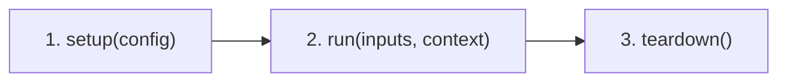

# FinForge AI — Component Creation from Scratch Guide

A comprehensive, step-by-step developer guide for designing, implementing, configuring, testing, and running custom FinForge AI components from first principles.

---

## Table of Contents

1. [Architectural Overview & Core Concepts](#1-architectural-overview--core-concepts)
   - [The Scratch-First Philosophy](#the-scratch-first-philosophy)
   - [The Three-Stage Lifecycle](#the-three-stage-lifecycle)
   - [Data Contracts & Port Types](#data-contracts--port-types)
2. [Component Project Structure](#2-component-project-structure)
3. [Creating a Component Project](#3-creating-a-component-project)
   - [Method A: Using the FinForge CLI](#method-a-using-the-finforge-cli)
   - [Method B: Using the Python SDK API](#method-b-using-the-python-sdk-api)
   - [Method C: Manual Construction from Scratch](#method-c-manual-construction-from-scratch)
4. [Step-by-Step Implementation from Scratch](#4-step-by-step-implementation-from-scratch)
   - [Step 1: Manifest Specification (`component.yaml`)](#step-1-manifest-specification-componentyaml)
   - [Step 2: Component Implementation (`component.py`)](#step-2-component-implementation-componentpy)
   - [Step 3: Packaging Definition (`pyproject.toml`)](#step-3-packaging-definition-pyprojecttoml)
   - [Step 4: Writing the Usage Example (`examples/basic_usage.py`)](#step-4-writing-the-usage-example-examplesbasic_usagepy)
   - [Step 5: Writing Comprehensive Unit Tests (`tests/test_component.py`)](#step-5-writing-comprehensive-unit-tests-teststest_componentpy)
5. [Testing & Validation](#5-testing--validation)
   - [Running the FinForge Validation Suite (`finforge test`)](#running-the-finforge-validation-suite-finforge-test)
   - [Direct Unit Testing via Pytest](#direct-unit-testing-via-pytest)
6. [Pipeline Integration & Dynamic Discovery](#6-pipeline-integration--dynamic-discovery)
   - [Dynamic Discovery via `ComponentRegistry`](#dynamic-discovery-via-componentregistry)
   - [Building and Executing in a Directed Acyclic Graph (DAG)](#building-and-executing-in-a-directed-acyclic-graph-dag)
7. [Best Practices & Error Handling](#7-best-practices--error-handling)

---

## 1. Architectural Overview & Core Concepts

### The Scratch-First Philosophy
FinForge AI rejects opaque abstractions and bloated dependency trees. Every component is an isolated, inspectable unit of computation with strict type boundaries, explicit state transitions, and deterministic lifecycle management.

### The Three-Stage Lifecycle
Every component in FinForge AI inherits from `finforge.component.BaseComponent` and strictly executes through three lifecycle states:



| Lifecycle Method | Signature | Responsibility |
|---|---|---|
| `setup(config)` | `def setup(self, config: dict[str, Any]) -> None` | Ingests configuration, validates parameters, allocates memory, loads weights, or prepares scratch buffers. |
| `run(inputs, context)` | `def run(self, inputs: dict[str, Any], context: dict[str, Any]) -> dict[str, Any]` | Executes core logic on validated inputs using runtime metadata. Returns dictionary mapping output port names to values. |
| `teardown()` | `def teardown(self) -> None` | Releases resources, closes file descriptors, and clears large GPU or CPU buffers. Default implementation is a safe no-op. |

### Data Contracts & Port Types
Communication across FinForge components relies on declared static data contracts. The framework enforces strict type compatibility across connected components before runtime execution:

Supported contract types:
- `string`: UTF-8 string text data.
- `integer`: Standard integer values.
- `float`: Floating-point scalar numbers.
- `boolean`: Boolean flags (`True` / `False`).
- `list`: Python list sequences.
- `dict`: Key-value mappings.
- `any`: Arbitrary untyped payloads (use sparingly).

---

## 2. Component Project Structure

A fully compliant FinForge AI component has the following layout:

```text
components/text-cleaner/
├── component.yaml               # Component declarative manifest
├── pyproject.toml               # Standalone packaging metadata
├── README.md                    # Component-specific documentation
├── src/
│   └── text_cleaner/
│       ├── __init__.py          # Public package exports
│       └── component.py         # BaseComponent implementation
├── examples/
│   └── basic_usage.py           # Standalone runnable demonstration
└── tests/
    └── test_component.py        # Pytest test cases
```

---

## 3. Creating a Component Project

### Method A: Using the FinForge CLI
The fastest way to scaffold an isolated component project is through the `finforge create` command:

```bash
python -m finforge.cli.main create text-cleaner \
    --destination ./components \
    --category data-processing \
    --version 0.1.0 \
    --description "Cleans text by normalizing whitespace and optionally lowercasing." \
    --author "FinForge Developer"
```

### Method B: Using the Python SDK API
You can also generate components programmatically:

```python
from pathlib import Path
from finforge.sdk import create_component_project

project_path = create_component_project(
    name="text-cleaner",
    destination=Path("./components"),
    description="Cleans text by normalizing whitespace and optionally lowercasing.",
    category="data-processing",
    version="0.1.0",
    author="FinForge Developer",
)
print(f"Component created at: {project_path}")
```

### Method C: Manual Construction from Scratch
To build a component completely by hand without scaffolding tools, proceed directly to Section 4.

---

## 4. Step-by-Step Implementation from Scratch

In this tutorial, we will build a complete, production-ready `text-cleaner` component from scratch.

### Step 1: Manifest Specification (`component.yaml`)
Create `components/text-cleaner/component.yaml`. This file defines the identity, entrypoint, configuration schema, and I/O contract ports:

```yaml
name: text-cleaner
version: "0.1.0"
description: Cleans text by normalizing whitespace and optionally lowercasing.
api_version: "1"
category: data-processing

entrypoint: text_cleaner.component:TextCleanerComponent

inputs:
  input_data:
    type: string
    required: true
    description: Raw input text string to be normalized.

outputs:
  output_data:
    type: string
    description: Normalized text string.

config:
  lowercase:
    type: boolean
    required: false
    default: false
    description: Whether to convert output text to lowercase.
```

### Step 2: Component Implementation (`component.py`)
Create `components/text-cleaner/src/text_cleaner/component.py`. Subclass `BaseComponent` and implement `setup()`, `run()`, and `teardown()`:

```python
"""Implementation of TextCleanerComponent."""

from __future__ import annotations

import re
from typing import Any

from finforge.component import BaseComponent
from finforge.exceptions import (
    ComponentConfigurationError,
    ComponentExecutionError,
    ComponentLifecycleError,
)


class TextCleanerComponent(BaseComponent):
    """Cleans text by normalizing whitespace and optionally lowercasing."""

    def __init__(self) -> None:
        self._is_configured: bool = False
        self._lowercase: bool = False

    def setup(self, config: dict[str, Any]) -> None:
        """Configure the text cleaner.
        
        Args:
            config: Configuration dictionary matching component.yaml config schema.
        """
        lowercase = config.get("lowercase", False)

        if not isinstance(lowercase, bool):
            raise ComponentConfigurationError("'lowercase' must be a boolean.")

        self._lowercase = lowercase
        self._is_configured = True

    def run(
        self,
        inputs: dict[str, Any],
        context: dict[str, Any],
    ) -> dict[str, Any]:
        """Clean the provided input text.
        
        Args:
            inputs: Dictionary containing input ports (expects 'input_data').
            context: Pipeline runtime execution context.
            
        Returns:
            Dictionary containing output ports ('output_data').
        """
        if not self._is_configured:
            raise ComponentLifecycleError(
                "Component must be configured via setup() before run()."
            )

        if "input_data" not in inputs:
            raise ComponentExecutionError("Missing required input port: 'input_data'.")

        raw_text = inputs["input_data"]

        if not isinstance(raw_text, str):
            raise ComponentExecutionError(
                f"Expected string input, got {type(raw_text).__name__}."
            )

        try:
            # Replace multiple consecutive whitespace characters with a single space
            cleaned = re.sub(r"\s+", " ", raw_text).strip()

            if self._lowercase:
                cleaned = cleaned.lower()

            return {"output_data": cleaned}
        except Exception as exc:
            raise ComponentExecutionError(f"Text cleaning failed: {exc}") from exc

    def teardown(self) -> None:
        """Release any allocated resources and reset state."""
        self._is_configured = False
        self._lowercase = False
```

Expose the component in `components/text-cleaner/src/text_cleaner/__init__.py`:

```python
"""Text Cleaner component package."""

from text_cleaner.component import TextCleanerComponent

__all__ = ["TextCleanerComponent"]
```

### Step 3: Packaging Definition (`pyproject.toml`)
Create `components/text-cleaner/pyproject.toml` so the component can be packaged or installed in editable mode:

```toml
[build-system]
requires = ["hatchling"]
build-backend = "hatchling.build"

[project]
name = "finforge-text-cleaner"
version = "0.1.0"
description = "Cleans text by normalizing whitespace and optionally lowercasing."
authors = [{ name = "FinForge Developer" }]
readme = "README.md"
requires-python = ">=3.11"
dependencies = []

[project.optional-dependencies]
dev = ["pytest>=8.0.0"]
```

### Step 4: Writing the Usage Example (`examples/basic_usage.py`)
Create `components/text-cleaner/examples/basic_usage.py` demonstrating how to instantiate, configure, run, and teardown the component:

```python
"""Basic usage example for TextCleanerComponent."""

from text_cleaner.component import TextCleanerComponent


def main() -> None:
    # 1. Instantiate the component
    component = TextCleanerComponent()

    # 2. Configure the component via setup()
    config = {"lowercase": True}
    component.setup(config)
    print(f"1. Configured TextCleanerComponent with: {config}")

    # 3. Supply inputs and context, then run()
    inputs = {
        "input_data": "  Hello     FinForge   AI! \n Welcome to   Text Cleaning.  "
    }
    context = {"execution_id": "example-run-001"}

    output = component.run(inputs, context=context)
    print(f"2. Input Text:  {inputs['input_data']!r}")
    print(f"3. Output Text: {output['output_data']!r}")

    # 4. Clean up resources via teardown()
    component.teardown()
    print("4. Component teardown complete.")


if __name__ == "__main__":
    main()
```

### Step 5: Writing Comprehensive Unit Tests (`tests/test_component.py`)
Create `components/text-cleaner/tests/test_component.py` to test lifecycle states, input errors, and transformations:

```python
import pytest
from finforge.exceptions import (
    ComponentConfigurationError,
    ComponentExecutionError,
    ComponentLifecycleError,
)
from text_cleaner.component import TextCleanerComponent


def test_text_cleaner_lifecycle() -> None:
    comp = TextCleanerComponent()
    
    # Must fail if run() is invoked before setup()
    with pytest.raises(ComponentLifecycleError):
        comp.run({"input_data": "test"}, context={})

    # Setup with valid configuration
    comp.setup({"lowercase": False})
    
    # Normalization run
    result = comp.run({"input_data": "  foo    bar  "}, context={})
    assert result == {"output_data": "foo bar"}

    # Teardown
    comp.teardown()
    with pytest.raises(ComponentLifecycleError):
        comp.run({"input_data": "test"}, context={})


def test_text_cleaner_lowercasing() -> None:
    comp = TextCleanerComponent()
    comp.setup({"lowercase": True})
    result = comp.run({"input_data": "  FOO   BAR  "}, context={})
    assert result == {"output_data": "foo bar"}


def test_text_cleaner_invalid_config() -> None:
    comp = TextCleanerComponent()
    with pytest.raises(ComponentConfigurationError):
        comp.setup({"lowercase": "not-a-bool"})


def test_text_cleaner_missing_input() -> None:
    comp = TextCleanerComponent()
    comp.setup({})
    with pytest.raises(ComponentExecutionError):
        comp.run({}, context={})
```

---

## 5. Testing & Validation

### Running the FinForge Validation Suite (`finforge test`)
FinForge provides an automated verification engine that checks manifest schemas, interface contracts, class hierarchies, and executes developer tests without modifying any code:

```bash
python -m finforge.cli.main test components/text-cleaner
```

Sample output:
```text
Testing Component: text-cleaner (v0.1.0)

                          Framework Validation Stages                           
┏━━━━━━━━━━━━━━━━━━━━━┳━━━━━━━━━┳━━━━━━━━━━━━━━━━━━━━━━━━━━━━━━━━━━━━━━━━━━━━━━┓
┃ Stage               ┃ Status  ┃ Details                                      ┃
┡━━━━━━━━━━━━━━━━━━━━━╇━━━━━━━━━╇━━━━━━━━━━━━━━━━━━━━━━━━━━━━━━━━━━━━━━━━━━━━━━┩
│ Manifest Schema     │ PASSED  │ Manifest 'text-cleaner' (v0.1.0) is valid.   │
├─────────────────────┼─────────┼──────────────────────────────────────────────┤
│ Class Structure     │ PASSED  │ Component class 'TextCleanerComponent'       │
│                     │         │ satisfies BaseComponent contract.            │
├─────────────────────┼─────────┼──────────────────────────────────────────────┤
│ Contracts & Ports   │ PASSED  │ Static port schema definitions are valid.    │
├─────────────────────┼─────────┼──────────────────────────────────────────────┤
│ Lifecycle Execution │ PASSED  │ Lifecycle executed cleanly.                  │
├─────────────────────┼─────────┼──────────────────────────────────────────────┤
│ Developer Tests     │ PASSED  │ 9 passed, 0 failed, 0 skipped                │
└─────────────────────┴─────────┴──────────────────────────────────────────────┘

Outcome: All component checks passed successfully.
```

### Direct Unit Testing via Pytest
Install the component in editable mode, then run pytest:

```bash
cd components/text-cleaner
pip install -e .
pytest tests/
```

---

## 6. Pipeline Integration & Dynamic Discovery

### Dynamic Discovery via `ComponentRegistry`
Components can be registered dynamically by pointing to their directories:

```python
from finforge.registry import ComponentRegistry

registry = ComponentRegistry()
registry.discover(search_paths=["components/"])

# Retrieve registered component
metadata = registry.get("text-cleaner")
component_class = metadata.load_class()
component_instance = component_class()
```

### Building and Executing in a Directed Acyclic Graph (DAG)
Combine multiple scratch components into an executable pipeline:

```python
from finforge.pipeline.builder import PipelineBuilder
from finforge.runtime.executor import PipelineExecutor

# 1. Build pipeline
builder = PipelineBuilder(name="nlp-cleaning-pipeline")
builder.add_step(
    step_id="cleaner_node",
    component_name="text-cleaner",
    config={"lowercase": True},
)

pipeline = builder.build()

# 2. Execute pipeline
executor = PipelineExecutor(pipeline)
result = executor.execute(
    initial_inputs={
        "cleaner_node": {
            "input_data": "  Financial   Document   Text   Extraction  "
        }
    }
)

print(result.node_outputs["cleaner_node"])
# {'output_data': 'financial document text extraction'}
```

---

## 7. Best Practices & Error Handling

1. **Keep Dependencies Minimal**: Components should rely on NumPy or Python standard libraries whenever possible.
2. **Raise FinForge Built-in Exceptions**:
   - `ComponentConfigurationError`: Raised during `setup()` if config parameters are invalid.
   - `ComponentLifecycleError`: Raised when methods are called out of order (e.g., `run()` before `setup()`).
   - `ComponentExecutionError`: Raised if inputs are malformed or runtime computation fails.
3. **Always Clean Up in `teardown()`**: Ensure GPU tensors, file pointers, and cache memory are released so long-running pipelines do not leak resources.
4. **Adhere to the Manifest Contract**: Output dictionary keys returned from `run()` must match the ports defined in `component.yaml`.
