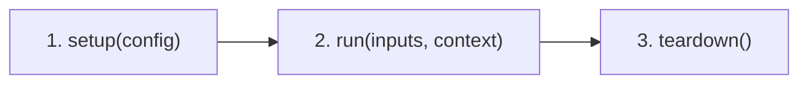

# FinForge AI — Component Creation Guide

A comprehensive, step-by-step developer guide for installing FinForge AI, scaffolding components with the CLI, implementing, testing, and running custom FinForge AI components.

---

## Table of Contents

1. [Architectural Overview & Core Concepts](#1-architectural-overview--core-concepts)
   - [The Scratch-First Philosophy](#the-scratch-first-philosophy)
   - [The Three-Stage Lifecycle](#the-three-stage-lifecycle)
   - [Data Contracts & Port Types](#data-contracts--port-types)
2. [Installation & Setup](#2-installation--setup)
   - [Install FinForge AI](#install-finforge-ai)
   - [Verify the CLI](#verify-the-cli)
   - [CLI Quick Reference](#cli-quick-reference)
3. [Component Project Structure](#3-component-project-structure)
4. [Creating a Component with the FinForge CLI](#4-creating-a-component-with-the-finforge-cli)
   - [Basic Scaffold](#basic-scaffold)
   - [All Available CLI Options](#all-available-cli-options)
   - [Adding a Component Directly into a Pipeline](#adding-a-component-directly-into-a-pipeline)
5. [Step-by-Step Implementation](#5-step-by-step-implementation)
   - [Step 1: Run `finforge create`](#step-1-run-finforge-create)
   - [Step 2: Edit the Manifest (`component.yaml`)](#step-2-edit-the-manifest-componentyaml)
   - [Step 3: Implement the Component (`component.py`)](#step-3-implement-the-component-componentpy)
   - [Step 4: Write a Usage Example (`examples/basic_usage.py`)](#step-4-write-a-usage-example-examplesbasic_usagepy)
   - [Step 5: Write Unit Tests (`tests/test_component.py`)](#step-5-write-unit-tests-teststest_componentpy)
6. [Testing & Validation](#6-testing--validation)
   - [Running the FinForge Validation Suite (`finforge test`)](#running-the-finforge-validation-suite-finforge-test)
   - [Direct Unit Testing via Pytest](#direct-unit-testing-via-pytest)
7. [Running a Component Standalone](#7-running-a-component-standalone)
8. [Pipeline Integration & Dynamic Discovery](#8-pipeline-integration--dynamic-discovery)
   - [Dynamic Discovery via `ComponentRegistry`](#dynamic-discovery-via-componentregistry)
   - [Building and Executing in a Directed Acyclic Graph (DAG)](#building-and-executing-in-a-directed-acyclic-graph-dag)
9. [Alternative: Python SDK Scaffolding](#9-alternative-python-sdk-scaffolding)
10. [Best Practices & Error Handling](#10-best-practices--error-handling)

---

## 1. Architectural Overview & Core Concepts

### The Scratch-First Philosophy
FinForge AI rejects opaque abstractions and bloated dependency trees. Every component is an isolated, inspectable unit of computation with strict type boundaries, explicit state transitions, and deterministic lifecycle management.

### The Three-Stage Lifecycle
Every component in FinForge AI inherits from `finforge.component.BaseComponent` and executes through three lifecycle states:



| Lifecycle Method | Signature | Responsibility |
|---|---|---|
| `setup(config)` | `def setup(self, config: dict[str, Any]) -> None` | Ingests configuration, validates parameters, allocates memory, loads weights, or prepares scratch buffers. |
| `run(inputs, context)` | `def run(self, inputs: dict[str, Any], context: dict[str, Any]) -> dict[str, Any]` | Executes core logic on validated inputs using runtime metadata. Returns dictionary mapping output port names to values. |
| `teardown()` | `def teardown(self) -> None` | Releases resources, closes file descriptors, and clears large GPU or CPU buffers. Default implementation is a safe no-op. |

### Data Contracts & Port Types
Communication across FinForge components relies on declared static data contracts. The framework enforces strict type compatibility across connected components before runtime execution:

Supported contract types:
- `string`: UTF-8 string text data.
- `integer`: Standard integer values.
- `float`: Floating-point scalar numbers.
- `boolean`: Boolean flags (`True` / `False`).
- `list`: Python list sequences.
- `dict`: Key-value mappings.
- `any`: Arbitrary untyped payloads (use sparingly).

---

## 2. Installation & Setup

### Install FinForge AI

FinForge AI requires **Python 3.11 or newer**. Install it from source in editable mode so the `finforge` CLI entrypoint becomes available globally in your environment:

```bash
# 1. Clone the repository
git clone https://github.com/finforge-ai/finforge-ai.git
cd finforge-ai

# 2. Create a virtual environment
python3 -m venv .venv
source .venv/bin/activate        # Windows: .venv\Scripts\activate

# 3. Install in editable mode with dev dependencies
pip install -e ".[dev]"
# or using requirements file:
pip install -r requirements-dev.txt
```

### Verify the CLI

After installation, confirm the `finforge` CLI is working:

```bash
finforge --version
# FinForge AI version 0.1.0.dev0

finforge --help
```

Expected output:

```
Usage: finforge [OPTIONS] COMMAND [ARGS]...

  FinForge AI CLI: A scratch-first, modular, open-source AI framework.

Commands:
  create           Create a new FinForge AI component project from the standard template.
  create-pipeline  Create a new FinForge AI pipeline project with local components directory.
  export           Export pipeline DAG topology to visual formats (Mermaid, DOT, Markdown).
  inspect          Inspect and display the topology of a serialized FinForge AI pipeline.
  run-component    Execute a FinForge AI component standalone with inputs and configuration.
  run-pipeline     Execute a serialized FinForge AI pipeline with topological runtime execution.
  test             Run architectural validation and developer tests on a component project.
  run              Execute FinForge AI components and pipelines.
```

### CLI Quick Reference

| Command | Purpose |
|---------|---------|
| `finforge create <name>` | Scaffold a new component project |
| `finforge test <path>` | Validate manifest, contracts, and run tests |
| `finforge run-component <path>` | Execute a component standalone |
| `finforge run-pipeline <file>` | Execute a pipeline from a YAML file |
| `finforge create-pipeline <name>` | Scaffold a new pipeline project |
| `finforge inspect <file>` | Inspect pipeline topology |
| `finforge export <file>` | Export pipeline DAG to Mermaid / DOT |

---

## 3. Component Project Structure

A fully compliant FinForge AI component has the following layout:

```text
components/text-cleaner/
├── component.yaml               # Component declarative manifest
├── pyproject.toml               # Standalone packaging metadata
├── README.md                    # Component-specific documentation
├── src/
│   └── text_cleaner/
│       ├── __init__.py          # Public package exports
│       └── component.py         # BaseComponent implementation
├── examples/
│   └── basic_usage.py           # Standalone runnable demonstration
└── tests/
    └── test_component.py        # Pytest test cases
```

> [!NOTE]
> The `finforge create` CLI command generates this entire structure automatically. You should **never** need to create these files manually.

---

## 4. Creating a Component with the FinForge CLI

The `finforge create` command is the **recommended and fastest way** to scaffold a new component. It generates the full project structure — manifest, implementation stub, packaging config, example, and tests — in a single command.

### Basic Scaffold

```bash
finforge create text-cleaner \
    --destination ./components \
    --category data-processing \
    --version 0.1.0 \
    --description "Cleans text by normalizing whitespace and optionally lowercasing." \
    --author "FinForge Developer"
```

This creates:

```
components/text-cleaner/
├── component.yaml
├── pyproject.toml
├── README.md
├── src/
│   └── text_cleaner/
│       ├── __init__.py
│       └── component.py        ← edit your logic here
├── examples/
│   └── basic_usage.py
└── tests/
    └── test_component.py
```

### All Available CLI Options

```
Usage: finforge create [OPTIONS] [name]

Arguments:
  name   Name of the component to create (e.g. 'text-cleaner')

Options:
  -d, --destination <path>   Directory where the component folder will be created.
                             [default: ./components]
      --description <str>    Human summary of component functionality.
  -c, --category <str>       AI/ML domain category (e.g. 'machine-learning', 'rag',
                             'data-processing', 'deep-learning').
                             [default: machine-learning]
      --version <str>        Initial component package version. [default: 0.1.0]
  -a, --author <str>         Author name or credit.
  -p, --pipeline <path>      Target pipeline directory to add this component into
                             (saves under <pipeline>/components).
      --help                 Show this message and exit.
```

### Adding a Component Directly into a Pipeline

If you already have a pipeline project, use `--pipeline` to place the component directly inside it:

```bash
finforge create sentiment-scorer \
    --pipeline ./components/pipelines/financial-risk-analysis \
    --category machine-learning \
    --description "Scores financial text sentiment on a 0–1 scale."
```

The component is created at `./components/pipelines/financial-risk-analysis/components/sentiment-scorer/`.

---

## 5. Step-by-Step Implementation

This tutorial walks through building a complete `text-cleaner` component using the CLI.

### Step 1: Run `finforge create`

```bash
finforge create text-cleaner \
    --destination ./components \
    --category data-processing \
    --version 0.1.0 \
    --description "Cleans text by normalizing whitespace and optionally lowercasing." \
    --author "FinForge Developer"
```

Expected output:

```
✓ Created component text-cleaner at ./components/text-cleaner
```

Install the scaffolded component in editable mode so imports work locally:

```bash
cd components/text-cleaner
pip install -e .
cd ../..
```

### Step 2: Edit the Manifest (`component.yaml`)

The CLI already created `components/text-cleaner/component.yaml` with a starter template. Open it and update the `inputs`, `outputs`, and `config` sections to match your component's contract:

```yaml
name: text-cleaner
version: "0.1.0"
description: Cleans text by normalizing whitespace and optionally lowercasing.
api_version: "1"
category: data-processing

entrypoint: text_cleaner.component:TextCleanerComponent

inputs:
  input_data:
    type: string
    required: true
    description: Raw input text string to be normalized.

outputs:
  output_data:
    type: string
    description: Normalized text string.

config:
  lowercase:
    type: boolean
    required: false
    default: false
    description: Whether to convert output text to lowercase.
```

### Step 3: Implement the Component (`component.py`)

The CLI generates a stub at `components/text-cleaner/src/text_cleaner/component.py`. Open it and fill in your `setup()`, `run()`, and `teardown()` logic:

```python
"""Implementation of TextCleanerComponent."""

from __future__ import annotations

import re
from typing import Any

from finforge.component import BaseComponent
from finforge.exceptions import (
    ComponentConfigurationError,
    ComponentExecutionError,
    ComponentLifecycleError,
)


class TextCleanerComponent(BaseComponent):
    """Cleans text by normalizing whitespace and optionally lowercasing."""

    def __init__(self) -> None:
        self._is_configured: bool = False
        self._lowercase: bool = False

    def setup(self, config: dict[str, Any]) -> None:
        """Configure the text cleaner.
        
        Args:
            config: Configuration dictionary matching component.yaml config schema.
        """
        lowercase = config.get("lowercase", False)

        if not isinstance(lowercase, bool):
            raise ComponentConfigurationError("'lowercase' must be a boolean.")

        self._lowercase = lowercase
        self._is_configured = True

    def run(
        self,
        inputs: dict[str, Any],
        context: dict[str, Any],
    ) -> dict[str, Any]:
        """Clean the provided input text.
        
        Args:
            inputs: Dictionary containing input ports (expects 'input_data').
            context: Pipeline runtime execution context.
            
        Returns:
            Dictionary containing output ports ('output_data').
        """
        if not self._is_configured:
            raise ComponentLifecycleError(
                "Component must be configured via setup() before run()."
            )

        if "input_data" not in inputs:
            raise ComponentExecutionError("Missing required input port: 'input_data'.")

        raw_text = inputs["input_data"]

        if not isinstance(raw_text, str):
            raise ComponentExecutionError(
                f"Expected string input, got {type(raw_text).__name__}."
            )

        try:
            # Replace multiple consecutive whitespace characters with a single space
            cleaned = re.sub(r"\s+", " ", raw_text).strip()

            if self._lowercase:
                cleaned = cleaned.lower()

            return {"output_data": cleaned}
        except Exception as exc:
            raise ComponentExecutionError(f"Text cleaning failed: {exc}") from exc

    def teardown(self) -> None:
        """Release any allocated resources and reset state."""
        self._is_configured = False
        self._lowercase = False
```

Expose the component in `components/text-cleaner/src/text_cleaner/__init__.py`:

```python
"""Text Cleaner component package."""

from text_cleaner.component import TextCleanerComponent

__all__ = ["TextCleanerComponent"]
```

### Step 3: Packaging Definition (`pyproject.toml`)

The CLI already generates `components/text-cleaner/pyproject.toml`. It looks like this — only edit it if you need to add extra pip `dependencies`:

```toml
[build-system]
requires = ["hatchling"]
build-backend = "hatchling.build"

[project]
name = "finforge-text-cleaner"
version = "0.1.0"
description = "Cleans text by normalizing whitespace and optionally lowercasing."
authors = [{ name = "FinForge Developer" }]
readme = "README.md"
requires-python = ">=3.11"
dependencies = []

[project.optional-dependencies]
dev = ["pytest>=8.0.0"]
```

### Step 4: Write a Usage Example (`examples/basic_usage.py`)

The CLI creates a stub at `components/text-cleaner/examples/basic_usage.py`. Update it to demonstrate your component's real inputs and config:

```python
"""Basic usage example for TextCleanerComponent."""

from text_cleaner.component import TextCleanerComponent


def main() -> None:
    # 1. Instantiate the component
    component = TextCleanerComponent()

    # 2. Configure the component via setup()
    config = {"lowercase": True}
    component.setup(config)
    print(f"1. Configured TextCleanerComponent with: {config}")

    # 3. Supply inputs and context, then run()
    inputs = {
        "input_data": "  Hello     FinForge   AI! \n Welcome to   Text Cleaning.  "
    }
    context = {"execution_id": "example-run-001"}

    output = component.run(inputs, context=context)
    print(f"2. Input Text:  {inputs['input_data']!r}")
    print(f"3. Output Text: {output['output_data']!r}")

    # 4. Clean up resources via teardown()
    component.teardown()
    print("4. Component teardown complete.")


if __name__ == "__main__":
    main()
```

### Step 5: Write Unit Tests (`tests/test_component.py`)

The CLI generates `components/text-cleaner/tests/test_component.py` with a starter test. Extend it to cover lifecycle states, bad configs, missing inputs, and your core logic:

```python
import pytest
from finforge.exceptions import (
    ComponentConfigurationError,
    ComponentExecutionError,
    ComponentLifecycleError,
)
from text_cleaner.component import TextCleanerComponent


def test_text_cleaner_lifecycle() -> None:
    comp = TextCleanerComponent()
    
    # Must fail if run() is invoked before setup()
    with pytest.raises(ComponentLifecycleError):
        comp.run({"input_data": "test"}, context={})

    # Setup with valid configuration
    comp.setup({"lowercase": False})
    
    # Normalization run
    result = comp.run({"input_data": "  foo    bar  "}, context={})
    assert result == {"output_data": "foo bar"}

    # Teardown
    comp.teardown()
    with pytest.raises(ComponentLifecycleError):
        comp.run({"input_data": "test"}, context={})


def test_text_cleaner_lowercasing() -> None:
    comp = TextCleanerComponent()
    comp.setup({"lowercase": True})
    result = comp.run({"input_data": "  FOO   BAR  "}, context={})
    assert result == {"output_data": "foo bar"}


def test_text_cleaner_invalid_config() -> None:
    comp = TextCleanerComponent()
    with pytest.raises(ComponentConfigurationError):
        comp.setup({"lowercase": "not-a-bool"})


def test_text_cleaner_missing_input() -> None:
    comp = TextCleanerComponent()
    comp.setup({})
    with pytest.raises(ComponentExecutionError):
        comp.run({}, context={})
```

---

## 6. Testing & Validation

### Running the FinForge Validation Suite (`finforge test`)
FinForge provides an automated verification engine that checks manifest schemas, interface contracts, class hierarchies, and executes developer tests without modifying any code:

```bash
finforge test components/text-cleaner
```

Sample output:
```text
Testing Component: text-cleaner (v0.1.0)

                          Framework Validation Stages                           
┏━━━━━━━━━━━━━━━━━━━━━┳━━━━━━━━━┳━━━━━━━━━━━━━━━━━━━━━━━━━━━━━━━━━━━━━━━━━━━━━━┓
┃ Stage               ┃ Status  ┃ Details                                      ┃
┡━━━━━━━━━━━━━━━━━━━━━╇━━━━━━━━━╇━━━━━━━━━━━━━━━━━━━━━━━━━━━━━━━━━━━━━━━━━━━━━━┩
│ Manifest Schema     │ PASSED  │ Manifest 'text-cleaner' (v0.1.0) is valid.   │
├─────────────────────┼─────────┼──────────────────────────────────────────────┤
│ Class Structure     │ PASSED  │ Component class 'TextCleanerComponent'       │
│                     │         │ satisfies BaseComponent contract.            │
├─────────────────────┼─────────┼──────────────────────────────────────────────┤
│ Contracts & Ports   │ PASSED  │ Static port schema definitions are valid.    │
├─────────────────────┼─────────┼──────────────────────────────────────────────┤
│ Lifecycle Execution │ PASSED  │ Lifecycle executed cleanly.                  │
├─────────────────────┼─────────┼──────────────────────────────────────────────┤
│ Developer Tests     │ PASSED  │ 9 passed, 0 failed, 0 skipped                │
└─────────────────────┴─────────┴──────────────────────────────────────────────┘

Outcome: All component checks passed successfully.
```

### Direct Unit Testing via Pytest

```bash
# Install the component first (only needed once)
cd components/text-cleaner
pip install -e .
cd ../..

# Run pytest
pytest components/text-cleaner/tests/
```

You can also skip pytest and run only the FinForge validation stages:

```bash
finforge test components/text-cleaner --skip-developer-tests
```

---

## 7. Running a Component Standalone

Before integrating into a pipeline, test your component standalone using `finforge run-component`:

```bash
finforge run-component components/text-cleaner \
    --input '{"input_data": "  Hello    FinForge   AI!  "}' \
    --config '{"lowercase": true}'
```

You can also supply inputs via a JSON/YAML file:

```bash
# inputs.json
# { "input_data": "  Hello    FinForge   AI!  " }

finforge run-component components/text-cleaner \
    --input-file inputs.json \
    --config '{"lowercase": true}'
```

---

## 8. Pipeline Integration & Dynamic Discovery

### Dynamic Discovery via `ComponentRegistry`
Components can be registered dynamically by pointing to their directories:

```python
from finforge.registry import ComponentRegistry

registry = ComponentRegistry()
registry.discover(search_paths=["components/"])

# Retrieve registered component
metadata = registry.get("text-cleaner")
component_class = metadata.load_class()
component_instance = component_class()
```

### Building and Executing in a Directed Acyclic Graph (DAG)
Combine multiple scratch components into an executable pipeline:

```python
from finforge.pipeline.builder import PipelineBuilder
from finforge.runtime.executor import PipelineExecutor

# 1. Build pipeline
builder = PipelineBuilder(name="nlp-cleaning-pipeline")
builder.add_step(
    step_id="cleaner_node",
    component_name="text-cleaner",
    config={"lowercase": True},
)

pipeline = builder.build()

# 2. Execute pipeline
executor = PipelineExecutor(pipeline)
result = executor.execute(
    initial_inputs={
        "cleaner_node": {
            "input_data": "  Financial   Document   Text   Extraction  "
        }
    }
)

print(result.node_outputs["cleaner_node"])
# {'output_data': 'financial document text extraction'}
```

---

## 9. Alternative: Python SDK Scaffolding

If you prefer to scaffold components programmatically (e.g. from a script or notebook), use the Python SDK instead of the CLI:

```python
from pathlib import Path
from finforge.sdk import create_component_project

project_path = create_component_project(
    name="text-cleaner",
    destination=Path("./components"),
    description="Cleans text by normalizing whitespace and optionally lowercasing.",
    category="data-processing",
    version="0.1.0",
    author="FinForge Developer",
)
print(f"Component created at: {project_path}")
```

This generates the exact same file structure as `finforge create`.

---

## 10. Best Practices & Error Handling

1. **Keep Dependencies Minimal**: Components should rely on NumPy or Python standard libraries whenever possible.
2. **Raise FinForge Built-in Exceptions**:
   - `ComponentConfigurationError`: Raised during `setup()` if config parameters are invalid.
   - `ComponentLifecycleError`: Raised when methods are called out of order (e.g., `run()` before `setup()`).
   - `ComponentExecutionError`: Raised if inputs are malformed or runtime computation fails.
3. **Always Clean Up in `teardown()`**: Ensure GPU tensors, file pointers, and cache memory are released so long-running pipelines do not leak resources.
4. **Adhere to the Manifest Contract**: Output dictionary keys returned from `run()` must match the ports defined in `component.yaml`.
