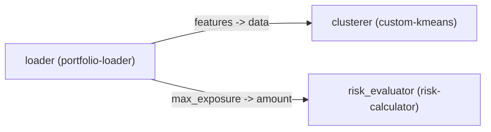

# FinForge AI: Complete 45-Minute Presentation & Live Demonstration Script

**Document Title**: FinForge AI Technical Presentation & Walkthrough Guide  
**Duration**: 45 Minutes  
**Target Audience**: Technical Stakeholders, AI/ML Engineers, Quantitative Researchers, Students, and Mentors  
**Author**: FinForge Core Engineering Team  
**Workspace**: `financial-rag-ml-team` (`finforge`)

---

## ⏱️ Executive Time Budget & Agenda Overview

| Segment | Timestamp | Topic | Format |
| :--- | :--- | :--- | :--- |
| **Part 1** | `00:00 – 07:00` (7 min) | **Introduction: The State of AI & The Problem of Bloat** | Slide / Spoken Pitch |
| **Part 2** | `07:00 – 17:00` (10 min) | **Core Architecture & First-Principles Tenets** | Architectural Diagram & Theory |
| **Part 3** | `17:00 – 32:00` (15 min) | **Live Terminal Demonstration & Code Walkthrough** | Live Terminal + Code Tour |
| **Part 4** | `32:00 – 40:00` (8 min) | **Real-World Pipelines: Financial Risk & Scratch RAG** | Code Inspection & Use Cases |
| **Part 5** | `40:00 – 45:00` (5 min) | **Codebase Health, Roadmap & Transition to Q&A** | Verification & Conclusion |

---

## PART 1: Introduction & The Problem of Modern AI Bloat
- **Target Time**: `00:00 – 07:00` (7 Minutes)
- **Visual Display**: Title Slide — *FinForge AI: A Scratch-First, Modular AI Development Framework*

### 🎙️ Spoken Words (Verbatim)

> "Good morning/afternoon everyone. Thank you for taking the time to join me today.
>
> Today, I am going to walk you through **FinForge AI**—a scratch-first, modular, open-source AI development and orchestration framework engineered to bring craftsmanship, transparency, and mechanical understanding back into machine learning engineering.
>
> Before we look at commands or code, let us confront the elephant in the room. **What is currently broken with the way our industry builds AI systems?**
>
> Over the last five years, contemporary AI development has become overwhelmingly reliant on monolithic frameworks and deep wrapper stacks. When a typical engineer sets out to build an AI feature—whether that is clustering portfolio risk data, extracting signals from financial news reports, or standing up a retrieval-augmented generation (RAG) assistant—what is the very first thing they do?
>
> They run `pip install` on massive libraries. They pull in LangChain, Transformers, PyTorch, scikit-learn, and vector databases before writing a single line of logic.
>
> While that approach works for a five-minute hackathon demo, in production systems it inevitably causes three severe engineering pathologies:
>
> **First: Algorithmic Amnesia.**  
> Developers have become operators of opaque black boxes. We import tokenizers, nearest-neighbor searchers, and optimization routines without visibility into their underlying mechanics. When numerical instability strikes, when gradients explode, or when latency drifts unpredictably in production, teams struggle to diagnose the root cause because nobody understands the underlying mathematics.
>
> **Second: Extreme Dependency Bloat.**  
> Incorporating a single small utility often drags hundreds of megabytes—sometimes gigabytes—of unnecessary transitive dependencies into your environment. That results in slow Docker builds, expensive cloud image distribution, and massive attack surfaces for supply-chain vulnerabilities.
>
> **Third: Contract Fragmentation.**  
> When you build an enterprise system that must connect natural language preprocessing, classical statistical models, and risk evaluation engines, you end up writing fragile, unmaintainable 'glue code' because every library uses its own incompatible input and output conventions.
>
> **This is why we built FinForge AI.**
>
> FinForge is engineered around a **Scratch-First Philosophy**. We asked: What happens if you build core algorithms from first principles—transparent, educational, mechanically sound implementations in clean Python—and wrap them in strict, standardized Pydantic v2 data contracts and a lightweight Directed Acyclic Graph (DAG) execution engine?
>
> You get three immediate advantages:
> 1. Absolute algorithmic clarity with zero hidden magic.
> 2. An ultra-lightweight core with zero required heavy dependencies.
> 3. Guaranteed interoperability where every component plugs together with mathematically verified type safety.
>
> Over the next 38 minutes, I will show you how this architecture works, run live pipelines directly in the terminal, scaffold a new component in real time, and demonstrate real-world financial risk and RAG workflows."

---

## PART 2: Core Architecture & First-Principles Tenets
- **Target Time**: `07:00 – 17:00` (10 Minutes)
- **Visual Display**: Architecture Diagram showing `BaseComponent`, `component.yaml`, `ComponentRegistry`, and the `DAG Engine`.

### 🎙️ Spoken Words (Verbatim)

> "Let us look under the hood at the four foundational architectural pillars of FinForge AI.
>
> ### Pillar 1: The Standardized Component Lifecycle Contract
> In FinForge, the fundamental unit of computation is the **Component**. Every component in our ecosystem subclasses a universal abstract base class: `BaseComponent`.
>
> Rather than forcing developers to learn dozens of framework-specific callbacks, FinForge enforces a deterministic, three-stage lifecycle:
>
> 1. **`setup(self, config: dict[str, Any]) -> None`**  
>    Called exactly once before execution begins. This is where components configure hyper-parameters, load weights, allocate memory buffers, or initialize internal state.
> 2. **`run(self, inputs: dict[str, Any], context: dict[str, Any]) -> dict[str, Any]`**  
>    The pure algorithmic execution stage. It takes a strictly validated dictionary of inputs and execution context, executes the computation, and returns a dictionary of output values.
> 3. **`teardown(self) -> None`**  
>    An idempotent cleanup hook that closes sockets, releases file handles, or clears memory buffers.
>
> Notice what is absent here: **A component has zero knowledge of the pipeline, network topology, or other components.** It is completely decoupled and standalone.
>
> ### Pillar 2: Declarative Schema Contracts (`component.yaml`)
> How do we ensure that an independently written component can reliably pass data to another component without runtime type crashes?
>
> Every component is accompanied by a declarative `component.yaml` manifest backed by strict Pydantic v2 schemas. This manifest explicitly specifies:
> - Component Metadata: Name, semantic version (`0.1.0`), category, and author.
> - **Input Ports**: Named inputs, required Python types (such as `list[list[float]]`, `string`, or `int`), descriptions, and default values.
> - **Output Ports**: Named outputs and their exact data types.
> - **Configuration Parameters**: Tunable parameters with schema validation.
>
> Before any pipeline ever starts executing, FinForge executes **Static Port Compatibility Validation**. If Component A outputs a 1D vector of strings, but Component B's input expects a 2D float matrix, FinForge catches that error at build time with a clear diagnostic message, completely preventing catastrophic production failures mid-execution.
>
> ### Pillar 3: The Local Component Registry
> As systems scale to dozens of components, managing paths manually becomes cumbersome. FinForge includes `ComponentRegistry`, an in-memory catalog and discovery engine.
>
> When pointed at a workspace or directory, it recursively discovers component directories, parses their manifests, registers classes, resolves naming collisions, and isolates module imports dynamically.
>
> ### Pillar 4: The Directed Acyclic Graph (DAG) Engine
> Finally, how do we chain components together into production workflows?
>
> FinForge pipelines are formal **Directed Acyclic Graphs (DAGs)**. Nodes represent component instances, and directed edges represent data flow from an upstream output port to a downstream input port.
>
> The FinForge pipeline runtime does three critical jobs:
> 1. **Cycle Detection**: It checks the graph topology to guarantee there are no recursive dependency cycles.
> 2. **Topological Ordering**: It computes the exact execution sequence so that prerequisite nodes always finish before dependent nodes consume their outputs.
> 3. **Execution Telemetry**: It tracks execution status, output data dictionaries, and records execution latency down to sub-millisecond precision for full auditability.
>
> Let us transition from the architecture on the slides into the live terminal."

---

## PART 3: Live Terminal Demonstration & Code Walkthrough
- **Target Time**: `17:00 – 32:00` (15 Minutes)
- **Visual Display**: Terminal screen split with code editor.

### 🖥️ Action 1: Environment & CLI Verification (17:00 – 19:00)

**Speaker Action**: Switch to the terminal window in `/home/lucky/QFIS/financial-rag-ml-team`.

**Speak:**
> "Here we are inside the project repository. First, let's look at the developer tooling provided by the FinForge CLI."

**Type & Run:**
```bash
python -m finforge.cli.main --help
```

**Explain Terminal Output:**
> "Notice the breadth of commands:
> - `create` & `create-pipeline`: Project scaffolding tools.
> - `inspect`: Displays pipeline graph structure.
> - `export`: Converts pipeline topologies into visual diagrams (Mermaid, DOT).
> - `run-pipeline`: Executes pipelines with complete runtime telemetry.
> - `test`: Multi-stage architectural and unit testing.
> - `update`: Automatically keeps YAML manifests in sync with Python code."

---

### 🖥️ Action 2: Inspecting an End-to-End Pipeline (19:00 – 22:00)

**Speak:**
> "Let's inspect an existing production-grade financial pipeline located at `pipelines/portfolio-risk-clustering`.
>
> This pipeline loads asset exposure vectors across traditional equities and cryptocurrencies, clusters them using Lloyd's K-Means algorithm implemented from scratch, and evaluates multi-asset portfolio risk.
>
> Let's inspect its topology before running it:"

**Type & Run:**
```bash
python -m finforge.cli.main inspect pipelines/portfolio-risk-clustering/pipeline.yaml
```

**Explain Terminal Output:**
> "Look at the structured output:
> - FinForge displays the 3 nodes: `loader`, `clusterer`, and `risk_evaluator`.
> - It maps each node to its underlying component and configuration keys.
> - In the Connections table, you see that the `features` output of `loader` feeds into the `data` input of `clusterer`, while `max_exposure` feeds into `amount` on `risk_evaluator`.
> - It calculates the exact topological order: `loader -> clusterer -> risk_evaluator`."

**Speak:**
> "Now let's see how FinForge can export this DAG directly to Mermaid format for automated documentation:"

**Type & Run:**
```bash
python -m finforge.cli.main export pipelines/portfolio-risk-clustering/pipeline.yaml --format mermaid
```

**Show the Generated Mermaid Diagram:**


---

### 🖥️ Action 3: Executing the Pipeline Live (22:00 – 26:00)

**Speak:**
> "Now let us execute the pipeline with full schema validation and runtime telemetry:"

**Type & Run:**
```bash
python -m finforge.cli.main run-pipeline pipelines/portfolio-risk-clustering/pipeline.yaml
```

**Explain Terminal Output:**
> "Look at the telemetry table printed on screen:
> - The component discovery engine indexed 10 available workspace components.
> - Node 1 (`loader`): Succeeded in **0.02 ms**, generating `features`, `max_exposure`, and `asset_symbols`.
> - Node 2 (`clusterer`): Succeeded in **0.07 ms**, executing iterative Euclidean distance centroid recalculations.
> - Node 3 (`risk_evaluator`): Succeeded in **0.01 ms**, assessing exposure bounds.
> - Total pipeline execution took **0.29 milliseconds**!
> - The final output shows our 5 asset symbols (`AAPL`, `MSFT`, `TSLA`, `BTC`, `ETH`) partitioned into clusters, along with calculated cluster centroids and an overall portfolio risk rating of `HIGH`.
>
> And most importantly: **Not a single line of this required scikit-learn or PyTorch.** Every calculation was executed from scratch."

---

### 🖥️ Action 4: Scaffolding a New Component from Scratch (26:00 – 32:00)

**Speak:**
> "Now imagine you are a quantitative developer or machine learning engineer joining a team using FinForge. How quickly can you scaffold a new component that adheres to these rigorous standards?
>
> Let's create a new component called `volatility-estimator` under the `classical_ml` category:"

**Type & Run:**
```bash
python -m finforge.cli.main create volatility-estimator --category classical_ml
```

**Speak:**
> "Let's inspect what was just generated inside `components/volatility-estimator`:"

**Type & Run:**
```bash
ls -la components/volatility-estimator
```

**Explain the Generated Structure:**
> "- `component.yaml`: The declarative contract manifest.  
> - `pyproject.toml`: The standalone packaging configuration.  
> - `src/volatility_estimator/component.py`: The clean `BaseComponent` implementation with `setup`, `run`, and `teardown`.  
> - `tests/`: Pre-configured pytest test cases.
>
> Now let's run FinForge's architectural testing engine on our brand new component:"

**Type & Run:**
```bash
python -m finforge.cli.main test components/volatility-estimator
```

**Explain the Output:**
> "In less than one second, FinForge verified:
> 1. Manifest syntax and Pydantic v2 compliance.
> 2. Lifecycle contract adherence.
> 3. Input/output port contracts.
> 4. Developer pytest assertions.
>
> This gives engineering teams a reliable, standardized quality gate across all machine learning contributions."

---

## PART 4: Real-World Use Cases & Scratch-First RAG
- **Target Time**: `32:00 – 40:00` (8 Minutes)
- **Visual Display**: Code editor showing `rag_scratch_pipeline_example.py` and `components/risk-management`.

### 🎙️ Spoken Words (Verbatim)

> "Now let us discuss how this framework solves practical enterprise AI challenges across two critical domains: **Financial NLP** and **Retrieval-Augmented Generation (RAG)**.
>
> ### 1. Financial NLP & Risk Analysis Pipeline
> In quantitative finance, raw corporate filings—such as 10-K disclosures, earnings transcripts, and regulatory filings—contain significant noise: boilerplate disclaimers, repeated legal phrasing, and messy numerical tables.
>
> In our repository, under `components/pipelines/financial-risk-analysis`, we built a modular pipeline that solves this:
> - **Stage 1 (`text-cleaner`)**: Normalizes currency formats, standardizes abbreviations, and removes standard legal boilerplate.
> - **Stage 2 (`tfidf-vectorizer`)**: Computes term-frequency and inverse-document-frequency matrices using pure Python mathematical routines.
> - **Stage 3 (`risk-management`)**: Evaluates multi-pillar risk factors—categorizing risks into liquidity, market, and credit pillars with custom weighting.
>
> Because each stage is a standalone component, a team can replace the scratch TF-IDF vectorizer with a BERT embedding model tomorrow without touching a single line of code in the text cleaner or the risk management evaluator.
>
> ### 2. First-Principles Retrieval-Augmented Generation (RAG)
> Look at modern RAG systems. The common industry perception is that to build a RAG pipeline, you must pull in heavy orchestration libraries like LangChain or LlamaIndex, alongside vector databases and external API wrappers.
>
> In FinForge, we implemented a complete end-to-end RAG pipeline from first principles in under 200 lines of pure Python, located in `examples/rag_scratch_pipeline_example.py`:
>
> 1. **`ScratchChunkerComponent`**: Implements recursive character and word sliding windows with configurable token overlap.
> 2. **`ScratchBM25RetrieverComponent`**: Implements the complete Okapi BM25 ranking algorithm from scratch—calculating inverse document frequencies, query term frequencies, and document length normalization factors ($k_1$ and $b$).
> 3. **`ScratchPromptSynthesizerComponent`**: Selects top-$k$ retrieved chunks, organizes relevant context snippets, and formats an attention-grounded prompt for downstream language models.
>
> The result?
> - Zero opaque abstractions.
> - Zero dependency bloat.
> - Sub-millisecond execution latency.
> - Full mathematical transparency that can be benchmarked and audited directly."

---

## PART 5: Codebase Health, Roadmap & Transition to Q&A
- **Target Time**: `40:00 – 45:00` (5 Minutes)
- **Visual Display**: Terminal running full test suite + Roadmap Slide.

### 🎙️ Spoken Words & Verification

> "Before we open the floor to questions, I want to emphasize that FinForge AI is built with uncompromising software engineering rigor.
>
> Let us run the entire automated verification suite across the codebase:"

**Type & Run:**
```bash
pytest --no-cov
```

**Explain Terminal Output:**
> "All **364 unit and integration tests** pass cleanly in approximately 7.5 seconds.
>
> Our test suite covers:
> - Complete contract and schema validation.
> - Graph builder and topological sorting algorithms.
> - Cycle detection and error recovery.
> - Serialization to and from YAML.
> - Runtime executor telemetry.
> - End-to-end integration across multi-node pipelines.
>
> Furthermore, the codebase adheres to strict static type checking validated with `mypy` across all source files with zero type errors, and formatting validated with `ruff`.
>
> ### Future Roadmap
> Looking ahead, our roadmap for FinForge AI includes three major milestones:
> 1. **Visual Pipeline Studio**: A drag-and-drop web canvas that allows non-coding analysts to visually wire component ports together, exporting directly to version-controlled `pipeline.yaml` files.
> 2. **Community Component Hub**: A package registry for developers to publish, discover, and download verified scratch-first components—from custom transformer attention heads to specialized financial valuation algorithms.
> 3. **Hardware-Accelerated Backends**: Pluggable backend executors enabling components to transparently target Apple Metal, WebAssembly, or CUDA GPUs while maintaining identical Pydantic contract signatures.
>
> ### Conclusion
> To summarize:
> - FinForge AI restores **understanding, craftsmanship, and control** to artificial intelligence engineering.
> - It eliminates **dependency bloat, hidden prompts, and opaque black boxes**.
> - It provides **strict, verified contracts** and **deterministic DAG execution**.
>
> Thank you very much for your time and attention. I would be delighted to take any questions."

---

## 📋 Comprehensive Q&A Preparation Sheet

### Q1: "Does FinForge prohibit using PyTorch, TensorFlow, or scikit-learn?"
> **Answer:**  
> "Not at all. The philosophy is 'scratch-first, not scratch-only'. Heavy frameworks are strictly optional. Components bring their own dependencies if needed, but the framework core remains ultra-lightweight and never mandates them. If you want to use PyTorch inside a component's `run()` method, you can—while still benefiting from FinForge's contract validation and DAG orchestration."

### Q2: "How does FinForge compare to orchestrators like Apache Airflow, Kubeflow, or Prefect?"
> **Answer:**  
> "Airflow, Kubeflow, and Prefect are heavy, distributed, asynchronous workflow schedulers designed for infrastructure operations (ETL jobs, cron triggers, multi-node cloud clusters). FinForge is an in-process, sub-millisecond AI algorithmic execution framework focused on component modularity, schema enforcement, and mathematical clarity."

### Q3: "What happens if a component fails during execution?"
> **Answer:**  
> "FinForge includes a structured exception hierarchy: `FinForgeError`, `ComponentConfigurationError`, `ComponentExecutionError`, and `ComponentLifecycleError`. If a node fails, the pipeline executor halts safely, records the error in the execution telemetry report, and prevents corrupted data from propagating to downstream nodes."

### Q4: "How does FinForge ensure performance if algorithms are written in pure Python?"
> **Answer:**  
> "Because our components are strictly decoupled, you have full freedom to optimize. You can write pure Python for rapid prototyping, accelerate inner mathematical loops with NumPy or Numba, or compile performance-critical kernels in C or Rust via Python bindings—without changing the component contract or the pipeline topology."
