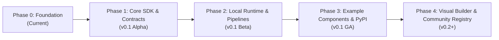

# FinForge AI

<div align="center">

**A scratch-first, modular, open-source AI development framework.**

[](https://github.com/finforge-ai/finforge-ai/actions/workflows/ci.yml)
[](https://www.python.org/)
[](LICENSE)
[-orange.svg)](#installation-status)

</div>

---

## What is FinForge AI?

**FinForge AI** is an open-source, modular AI framework engineered around a **scratch-first** philosophy. It provides the architectural scaffolding, standardized contracts, and composable execution runtimes needed to build artificial intelligence and machine learning components from first principles.

Instead of treating modern AI as opaque black boxes or forcing rigid adherence to monolithic libraries, FinForge AI empowers developers, researchers, and students to implement algorithms from the ground up, validate them against rigorous contracts, and compose them into production-ready pipelines.

> **Name & Identity**: The name *FinForge* reflects our commitment to craftsmanship, precision, and engineering discipline (forging intelligence with rigorous standards). The framework is **general-purpose** and domain-agnostic, spanning all primary AI paradigms.

---

## Why FinForge AI?

Contemporary AI development is heavily reliant on massive, monolithic frameworks and wrappers around wrappers. While convenient for rapid prototyping, this introduces significant trade-offs:

- **Loss of Algorithmic Understanding**: Developers frequently import models without visibility into underlying mechanisms, tokenizers, attention operations, or optimization dynamics.
- **Dependency Bloat**: Incorporating a single lightweight component often pulls hundreds of megabytes of unnecessary dependencies into production environments.
- **Contract Fragmentation**: Connecting independently written algorithms across Classical ML, Deep Learning, RAG, and Agentic systems often requires fragile custom glue code.

**FinForge AI solves this by introducing:**

1. **First-Principles Implementation**: Clear, transparent, scratch-built components that emphasize algorithmic clarity and mechanical sympathy.
2. **Standardized Component Contracts**: Pydantic v2-backed interfaces and declarative manifests guaranteeing interoperability across domains.
3. **Lightweight Core**: A clean, minimal dependency footprint. Frameworks like PyTorch, TensorFlow, Transformers, or LangChain are strictly optional and never mandated by core runtime systems.
4. **Composability**: Seamless chaining of scratch-built components into directed execution pipelines.

---

## The Scratch-First Philosophy

In FinForge AI, **scratch-built components are our primary differentiator**:

- **Understand Before Abstracting**: Implement the mathematical formulations—gradient descent routines, attention heads, vector similarity metrics, BM25 rankers, or memory routers—directly.
- **No Hidden Magic**: Code paths are readable, debuggable, and educational.
- **Interchangeable by Design**: A scratch-built nearest-neighbor search component obeys the identical contract as an accelerated external library, allowing drop-in substitution and fair benchmarking.

---

## Supported AI Domains

FinForge AI is engineered to provide standardized contracts across six core AI disciplines:

1. **Classical Machine Learning**: Scratch implementations of linear models, tree-based methods, clustering algorithms, dimensionality reduction, and evaluation metrics.
2. **Deep Learning**: Neural network foundations, tensor operations, layer architectures, activation functions, loss formulations, and backpropagation mechanics.
3. **Large Language Models (LLMs)**: Tokenizers, positional encodings, self-attention blocks, transformer architectures, sampling strategies, and prompt orchestration.
4. **Retrieval-Augmented Generation (RAG)**: Chunking algorithms, embedding generation, dense and sparse retrieval (BM25 / vector indexing), reranking engines, and grounded answer synthesis.
5. **Agentic AI**: ReAct loops, planning modules, tool-use execution interfaces, scratch-built memory stores, and reflection mechanisms.
6. **Multimodal AI**: Image feature extractors, cross-attention projection layers, vision-language alignment, and multimodal fusion pipelines.

---

## Key Proposed Features

- **Component SDK**: Standardized base contracts, lifecycle stages (`configure`, `initialize`, `execute`, `teardown`), and strict type boundaries.
- **Component Manifest (`finforge.yaml`)**: Declarative metadata, semantic versioning, domain categorization, and input/output contract specifications.
- **Contract Validation**: Runtime and build-time validation ensuring schema compatibility before pipeline execution.
- **Local Component Registry**: Automatic workspace indexing, discovery, and resolution of local components.
- **Pipeline Builder API**: Python API to assemble, validate, and execute directed acyclic graphs (DAGs) of components.
- **Local Runtime Engine**: Deterministic, lightweight execution engine supporting synchronous and asynchronous flows.
- **CLI Suite**: Command-line developer tools (`finforge`) for project inspection, component scaffolding, and pipeline verification.
- **Visual Pipeline Builder** *(Planned for a future milestone)*: Interactive visual interface for designing, configuring, and inspecting execution graphs.
- **Community Component Registry** *(Planned for a future milestone)*: Online package ecosystem for discovering and sharing verified community components.

---

## Installation Status

> [!IMPORTANT]
> **FinForge AI is currently in early pre-alpha development (`0.1.0.dev0`) and is NOT yet published to PyPI.**  
> The repository currently contains the initial structural foundation, build configuration, and architectural specifications. Functional components and runtime logic are actively being implemented through tracked milestones.

Do not attempt to `pip install finforge-ai` from the public PyPI index at this time. To test or contribute to the foundation, install locally from source as described below.

---

## Development Setup

FinForge AI requires **Python 3.11 or newer**.

### 1. Clone the Repository

```bash
git clone https://github.com/Q-FIS/Finforge-ai.git
cd Finforge-ai
```

### 2. Create a Virtual Environment

Using standard Python virtual environments:

```bash
python3 -m venv .venv
# On Linux
source .venv/bin/activate
# On windows
.venv\Scripts\activate
```

Or using [`uv`](https://docs.astral.sh/uv/):

```bash
uv venv
source .venv/bin/activate
```

### 3. Install in Editable Mode with Development Dependencies

```bash
pip install -r requirements-dev.txt
# Alternatively:
pip install -e ".[dev]"
```

### 4. Verify Installation and Tooling

```bash
# Verify the CLI entrypoint
finforge --help
finforge --version

# Run the test suite
pytest

# Check formatting and linting
ruff check .
ruff format --check .

# Run static type checking
mypy
```

---

## Quick Start & Example Usage

FinForge AI enables you to build modular AI/ML components from scratch, compose them into directed acyclic graph (DAG) pipelines, execute them locally with contract enforcement, and save/load workflows to portable YAML.

### 1. Building and Running a Pipeline in Python

```python
from typing import Any
from finforge import ComponentManifest, ComponentRegistry, Pipeline, PortDefinition
from finforge.component import BaseComponent


# Step 1: Define modular components inheriting from BaseComponent
class FinancialDataLoader(BaseComponent):
    """Produces raw financial transactions."""

    def setup(self, config: dict[str, Any]) -> None:
        self.batch_size = config.get("batch_size", 100)

    def run(self, inputs: dict[str, Any], context: dict[str, Any]) -> dict[str, Any]:
        return {
            "transactions": [
                {"id": "tx_1", "amount": 120.0, "risk_score": 0.15},
                {"id": "tx_2", "amount": 95000.0, "risk_score": 0.92},
            ]
        }


class AnomalyDetector(BaseComponent):
    """Filters high-risk transactions exceeding threshold."""

    def setup(self, config: dict[str, Any]) -> None:
        self.threshold = float(config.get("threshold", 0.75))

    def run(self, inputs: dict[str, Any], context: dict[str, Any]) -> dict[str, Any]:
        records = inputs["transactions"]
        flagged = [r for r in records if r["risk_score"] >= self.threshold]
        return {"flagged": flagged}


# Step 2: Register components with typed manifests
registry = ComponentRegistry()

registry.register(
    FinancialDataLoader,
    ComponentManifest(
        name="financial-loader",
        version="1.0.0",
        description="Ingests transaction data",
        category="data-processing",
        entrypoint="app:FinancialDataLoader",
        outputs={"transactions": PortDefinition(type="array")},
    ),
)

registry.register(
    AnomalyDetector,
    ComponentManifest(
        name="anomaly-detector",
        version="1.0.0",
        description="Flags anomalous risk scores",
        category="data-processing",
        entrypoint="app:AnomalyDetector",
        inputs={"transactions": PortDefinition(type="array")},
        outputs={"flagged": PortDefinition(type="array")},
    ),
)

# Step 3: Construct the pipeline using the Builder API
pipeline = Pipeline(
    name="fraud-detection-pipeline",
    registry=registry,
    description="Identifies fraudulent transactions",
)

pipeline.add("loader", "financial-loader", config={"batch_size": 250})
pipeline.add("detector", "anomaly-detector", config={"threshold": 0.85})
pipeline.connect("loader", "transactions", "detector", "transactions")

# Step 4: Validate structural DAG invariants and port compatibility
pipeline.validate()
print(f"Topological order: {pipeline.execution_order()}")
# Output: ['loader', 'detector']

# Step 5: Execute synchronously via the runtime executor
result = pipeline.run()
print(f"Success: {result.success}")
print(f"Flagged transactions: {result.outputs['detector']['flagged']}")
```

---

### 2. Saving and Loading Pipelines (YAML Serialization)

FinForge AI provides portable, versioned YAML serialization (`format_version: "1"`) without executing code or dynamic Python imports:

#### Saving a Workflow
```python
# Atomic write: writes safely to a temporary file before replacement
pipeline.save("fraud_pipeline.yaml")

# Pass overwrite=True to allow replacing existing files
pipeline.save("fraud_pipeline.yaml", overwrite=True)
```

The generated YAML definition is human-readable and independent of Python memory details:
```yaml
format_version: "1"
name: fraud-detection-pipeline
description: Identifies fraudulent transactions
nodes:
  - id: loader
    component: financial-loader
    config:
      batch_size: 250
  - id: detector
    component: anomaly-detector
    config:
      threshold: 0.85
edges:
  - source_node: loader
    source_port: transactions
    destination_node: detector
    destination_port: transactions
```

#### Loading a Workflow
```python
from finforge import Pipeline

# Load and reconstruct pipeline into a functional instance
restored_pipe = Pipeline.load("fraud_pipeline.yaml", registry=registry)

# Re-validate and execute
restored_pipe.validate()
exec_result = restored_pipe.run()
```

> [!NOTE]
> **Safety Guarantee**: `Pipeline.load()` only deserializes structure and validates graph invariants. It **never instantiates** components and **never calls** `setup()` or `run()` during loading.

---

### 3. Command-Line Interface (CLI)

The `finforge` CLI provides developer tooling to scaffold, test, and inspect components and pipelines:

#### Inspecting Pipeline Topology (`finforge inspect`)
Inspect any pipeline YAML file without executing Python code:

```bash
# Pretty-print pipeline nodes, components, connections, and execution order
finforge inspect fraud_pipeline.yaml

# Output machine-readable JSON for CI/CD automation
finforge inspect fraud_pipeline.yaml --json
```

#### Visualizing and Exporting Pipelines (`finforge export`)
Export serialized pipeline graphs into standard visual diagram formats (Mermaid, Graphviz DOT, Markdown):

```bash
# Export Mermaid diagram directly to terminal
finforge export pipeline.yaml

# Export to a file for GitHub/GitLab markdown documentation or Obsidian
finforge export pipeline.yaml --format mermaid --output pipeline.mmd

# Export to Graphviz DOT format for rendering with dot/graphviz
finforge export pipeline.yaml --format dot -o pipeline.dot

# Export a complete Markdown summary with embedded diagram and schema tables
finforge export pipeline.yaml --format markdown -o pipeline.md
```

#### Scaffolding a New Component (`finforge create`)
Generate a complete, production-ready component package with tests and examples:

```bash
finforge create risk-scorer --category evaluation --destination components/
```

#### Testing Components (`finforge test`)
Run framework validation (manifest schemas, class structure, port contracts, and lifecycle stages) plus developer unit tests:

```bash
finforge test components/risk-scorer/
```

#### Running Components Standalone (`finforge run component`)
Execute any component standalone with inputs, configuration, contract verification, and execution timing telemetry:

```bash
# Execute standalone component (auto-synthesizes valid sample inputs if omitted)
finforge run component components/text-cleaner

# Execute with custom inputs and config parameters
finforge run component components/text-cleaner \
  --input '{"input_data": "  HELLO   WORLD  "}' \
  --config '{"lowercase": true}'

# Execute with input/config JSON files
finforge run component components/text-cleaner --input-file inputs.json --config-file config.json

# Machine-readable JSON output for automated scripting
finforge run component components/text-cleaner --json

# Direct alias is also supported
finforge run-component components/text-cleaner --input '{"input_data": "test"}'
```

#### Running Pipelines with Topological Runtime (`finforge run pipeline`)
Execute end-to-end multi-component pipelines synchronously according to deterministic topological dependency order:

```bash
# Execute a pipeline definition with external inputs
finforge run pipeline components/pipelines/financial-risk-analysis \
  --inputs '{"texts": ["Revenue surged 34% YoY with record operating cash flow."]}'

# Execute pipeline YAML file directly
finforge run pipeline components/pipelines/financial-risk-analysis/pipeline.yaml \
  --inputs '{"text_cleaner": {"texts": ["Credit rating downgraded to B-."]}}'

# Load external inputs from a JSON or YAML file
finforge run pipeline components/pipelines/financial-risk-analysis --inputs-file inputs.json

# Machine-readable JSON output for CI/CD test automation
finforge run pipeline components/pipelines/financial-risk-analysis --inputs-file inputs.json --json

# Direct alias is also supported
finforge run-pipeline components/pipelines/financial-risk-analysis --inputs-file inputs.json
```

---

### 4. Executable Examples in Repository

You can run complete, self-contained end-to-end examples located under [`examples/`](examples/):

```bash
# 1. Pipeline Serialization & Inspection Example (FF-11)
python examples/pipeline_serialization_example.py

# 2. Local Synchronous Runtime Execution Example (FF-10)
python examples/pipeline_runtime_example.py

# 3. Pipeline Builder API Example (FF-09)
python examples/pipeline_builder_example.py
```

---

## Project Architecture & v0.1 Goals

For a detailed technical breakdown of the planned architectural subsystems, please consult our [Architecture Specification](docs/architecture.md).

### v0.1 Development Goals

The current milestone focuses on establishing the minimal, rock-solid core foundation:

- [x] Initial repository structure and packaging configuration (Hatchling, PEP 621).
- [x] Development toolchain (Ruff, MyPy strict typing, Pytest, GitHub Actions CI).
- [x] Architecture specification and contribution standards.
- [x] Core `BaseComponent` interface and standardized lifecycle execution model (FF-01).
- [x] Pydantic v2 Component Manifest schema and parsing engine (FF-02).
- [x] Runtime contract schema validation and static port compatibility engine (FF-03).
- [x] In-memory Component Registry with metadata indexing and collision protection (FF-04).
- [x] Reusable component templates and programmatic SDK scaffolding (FF-05).
- [x] Modular developer CLI with component scaffolding command (`finforge create` — FF-06).
- [x] Component testing and verification engine (`finforge test` — FF-07).
- [x] Pipeline graph representation and DAG topological validation (FF-08).
- [x] In-process local pipeline builder API (FF-09).
- [x] Local synchronous DAG runtime executor (FF-10).
- [x] Declarative pipeline serialization, versioned YAML save/load, and topology inspection (`finforge inspect` — FF-11).

---

## Project Roadmap



- **Phase 0 (Current)**: Repository foundation, CI/CD, development quality standards, architecture roadmap.
- **Phase 1 (v0.1 Alpha)**: Component SDK, manifest schemas, contract validation, and local registry discovery.
- **Phase 2 (v0.1 Beta)**: Pipeline builder API, local runtime DAG executor, and CLI scaffolding tools.
- **Phase 3 (v0.1 GA)**: Comprehensive test suite, initial scratch components across all 6 domains, documentation site, and initial PyPI release.
- **Phase 4 (v0.2+)**: Visual pipeline builder, streaming execution, telemetry plugins, and community component registry.

---

## Contributing

We welcome contributions from developers, researchers, and students interested in algorithmic clarity and modular AI design!

Please read our [Contributing Guide](CONTRIBUTING.md) and [Code of Conduct](CODE_OF_CONDUCT.md) before submitting issues or pull requests.

---

## License

FinForge AI is proposed and licensed under the [Apache License 2.0](LICENSE).
