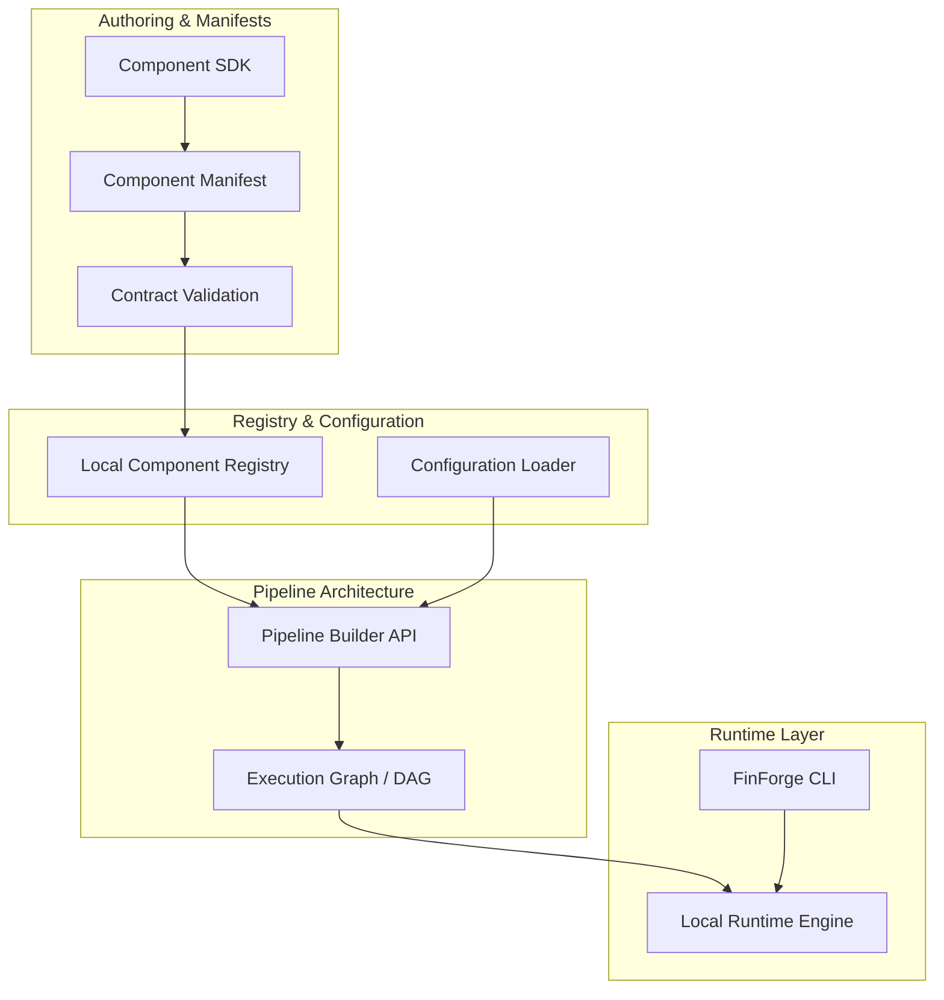

# FinForge AI Architecture Specification (v0.1 Proposed)

> **Document Status**: Architectural Design & Roadmap Specification  
> **Current Version**: `0.1.0.dev0`  
> **Implementation State**: Repository foundation initialized; architectural components detailed below are planned for incremental implementation.

---

## 1. Overview & Architectural Principles

FinForge AI is a modular, scratch-first AI development framework designed to allow practitioners, researchers, and students to build, validate, and compose AI components from first principles.

### Key Tenets

1. **Scratch-First Modular Components**: Focus on transparent, inspectable implementations of algorithms rather than opaque black-box abstractions.
2. **Standardized Contracts**: Strict schema enforcement at boundaries using Pydantic v2 ensures interoperability across independently developed components.
3. **Decoupled Architecture**: Components are standalone entities that can run independently or be orchestrated into pipelines.
4. **Lightweight Core**: Heavy frameworks (PyTorch, TensorFlow, Transformers, LangChain) are never required by the framework core. Components bring their own specific runtime requirements.
5. **Local-First Execution**: The initial v0.1 focus is reliable, reproducible local execution on developer machines.

---

## 2. Implementation Status: Implemented vs. Planned

To maintain technical credibility, this matrix explicitly separates the initialized foundation from planned architectural subsystems:

| Subsystem | Status | Description |
| :--- | :--- | :--- |
| **Repository Foundation** | **Implemented** | Clean `src/` layout, Hatchling packaging, Pytest, Ruff, and MyPy configuration. |
| **CLI (`finforge`)** | **Implemented (FF-06)** | Modular Typer command-line interface with version display and component creation (`finforge create`). |
| **CI / Developer Tooling** | **Implemented** | GitHub Actions workflow matrix (Python 3.11–3.13), templates, contributor guides. |
| **Component SDK (`BaseComponent`)** | **Implemented (FF-01)** | Universal `BaseComponent` lifecycle interface (`setup`, `run`, `teardown`), exception hierarchy, and `ExampleComponent`. |
| **Component Manifest Schema** | **Implemented (FF-02)** | Declarative `component.yaml` Pydantic v2 schema, strict validation rules, and `load_manifest` parser engine. |
| **Contract Validation** | **Implemented (FF-03)** | Runtime input/output schema validation engine and static port compatibility checker. |
| **Component Registry (Local)** | **Implemented (FF-04)** | In-memory catalog mapping component names, classes, and manifests with collision protection and category queries. |
| **Component Scaffolding (SDK)** | **Implemented (FF-05)** | Programmatic template generator (`create_component_project`) with name normalization, collision safety, and zero execution. |
| **Component Testing Engine** | **Implemented (FF-07)** | Multi-stage framework validator, lifecycle checker, and developer pytest runner (`finforge test`). |
| **Pipeline Builder (Code API)** | *Planned (v0.1)* | Python API for composing directed acyclic graphs (DAGs) of components. |
| **Local Runtime Engine** | *Planned (v0.1)* | Synchronous and asynchronous in-process pipeline executor. |
| **Configuration Subsystem** | *Planned (v0.1)* | Unified YAML / environment variable / programmatic config loader. |
| **Package Management / CLI Tooling** | *Planned (v0.1+)* | Component scaffolding (`finforge new`), local installation, validation. |
| **Visual Pipeline Builder** | *Planned (Future)* | Interactive graphical builder for non-code and hybrid pipeline editing. |
| **Community Registry & Cloud Runtime** | *Planned (Future)* | Centralized component repository and distributed cloud execution. |

---

## 3. Core Architecture Subsystems (Proposed v0.1)



---

### 3.1 Component SDK (Implemented in FF-01)

The Component SDK defines the foundational contracts all FinForge AI components implement.

- **Universal Base Interface**: Every component subclasses `BaseComponent` (`finforge.component.BaseComponent`).
- **Minimal Interface Footprint**: Components only define three lifecycle methods:
  - `setup(self, config: dict[str, Any]) -> None`: Prepares state, allocates memory, loads local assets.
  - `run(self, inputs: dict[str, Any], context: dict[str, Any]) -> dict[str, Any]`: Executes core operations, consuming inputs and runtime context, returning dictionary outputs.
  - `teardown(self) -> None`: Optional, idempotent resource cleanup hook.
- **Strict Error Handling**: Minimal exception hierarchy (`FinForgeError` -> `ComponentError` -> `ComponentConfigurationError`, `ComponentExecutionError`, `ComponentLifecycleError`).
- **Isolation**: Components do not depend directly on the pipeline engine; they depend only on the minimal SDK interface primitives.

### 3.2 Component Lifecycle Contract

Every component adheres to a deterministic, three-stage lifecycle:

```text
       [ UNINITIALIZED ] 
              │
              │  setup(config)
              ▼
          [ READY ] ◄───────────────┐
              │                     │
              │  run(inputs, ctx)   │ repeat execution
              ▼                     │
         [ EXECUTING ] ─────────────┘
              │
              │  teardown()
              ▼
        [ TERMINATED ]
```

1. **`setup(config)`**: Called once to configure and initialize internal state and load local assets. Validates required configuration keys; raises `ComponentConfigurationError` on failure.
2. **`run(inputs, context)`**: Evaluates component logic on input dictionary within provided execution context. Must be invoked only after `setup()`; raises `ComponentLifecycleError` if uninitialized, or `ComponentExecutionError` on execution/input failure.
3. **`teardown()`**: Releases file handles, memory buffers, or temporary files. Safe and idempotent to call multiple times. Subclasses override optionally; default is a safe no-op.

### 3.3 Component Manifest (`component.yaml` — Implemented in FF-02)

Components are described declaratively via a component manifest (`component.yaml`):

- **Metadata**: Component `name` (slug format), PEP 440 `version`, `description`, `api_version` (`"1"`), and `category`.
- **Domain Categorization**: One of the supported domains (`machine-learning`, `classical-ml`, `deep-learning`, `llm`, `rag`, `agentic`, `agents`, `multimodal`, `data-processing`, `evaluation`).
- **Entrypoint**: Import identifier `<module_path>:<class_name>` validated without executing code or importing modules.
- **I/O Ports (`inputs` / `outputs`)**: Strongly typed port definitions (`string`, `integer`, `float`, `boolean`, `array`, `object`, `tensor`, `dataframe`, `binary`, `any`) with optional descriptions and required flags.
- **Configuration Contract (`config`)**: Declared parameter types (`string`, `integer`, `float`, `boolean`, `list`, `dict`, etc.) with default value type verification.
- **Dependencies**: Explicit PEP 508 dependency specifiers validated via `packaging.requirements`.
- **Parser Engine**: `finforge.manifest.load_manifest(path)` and `parse_manifest(content)` provide zero-execution inspection with actionable `ManifestValidationError` diagnostics.

### 3.4 Contract Validation (Implemented in FF-03)

Contract validation ensures predictable data flow and catches schema mismatches:

- **Runtime Input Validation (`validate_inputs`)**: Verifies required inputs are present, rejects undeclared inputs, and validates types recursively (including array item schemas) without mutating data. Distinguishes booleans from integers.
- **Runtime Output Validation (`validate_outputs`)**: Validates emitted output dictionaries against declared port schemas and prevents leakage of undeclared state.
- **Static Compatibility Engine (`check_port_compatibility`)**: Analyzes whether producer output ports can safely connect to consumer input ports at graph assembly time without executing component code. Enforces numeric widening (integer -> number/float) and prohibits unsafe narrowing (number -> integer).
- **Diagnostics**: Rich [`ContractValidationError`](file:///home/lucky/QFIS/financial-rag-ml-team/src/finforge/exceptions.py#L48) and [`PortIncompatibleError`](file:///home/lucky/QFIS/financial-rag-ml-team/src/finforge/exceptions.py#L64) exceptions identifying field names, expected types, and actual types.

### 3.5 Component Registry (Local v0.1 — Implemented in FF-04)

The local component registry acts as an in-memory catalog of registered components:

- **Metadata & Class Storage**: Binds concrete `BaseComponent` classes with validated `ComponentManifest` metadata without instantiating or executing components.
- **Strict Validation**: Validates class inheritance, manifest data structure, and ensures manifest entrypoints match registered component classes.
- **Catalog Management**: Provides registration, collision prevention, retrieval, unregistration, clearing, existence checking (`in`), and category filtering.
- **Defensive Immutability**: All returned manifests are deep-copied to prevent accidental mutation of internal registry state.
- **Future Evolution**: Filesystem scanning (`components/`, site-packages), dynamic import resolution, and remote community hub package installation will build upon this foundation in future milestones.

### 3.6 Component Scaffolding & SDK Utilities (Implemented in FF-05)

The Component SDK provides programmatic utilities for generating new component projects:

- **Template System**: Standard directory layout (`templates/component/`) containing `component.yaml`, `pyproject.toml`, `README.md`, `src/`, `tests/`, and `examples/`.
- **Safe Identifiers**: Rigorous normalization and validation of component names, Python package identifiers, and PascalCase class names (`finforge.sdk.normalization`).
- **Filesystem Security**: Enforces non-destructive scaffolding; prevents directory collisions (`DestinationExistsError`) and guards against path traversal attacks (`PathTraversalError`).
- **Zero Execution**: Scaffolding operates entirely through static token substitution without instantiating or executing generated component code.

### 3.7 Component Testing Engine (Implemented in FF-07)

The Component Testing Engine (`finforge.testing`) provides automated verification of custom components against FinForge architectural specifications:

- **Multi-Stage Framework Validation**:
  - `manifest`: Verifies existence and strict Pydantic v2 compliance of `component.yaml`.
  - `structure`: Validates component Python package layout, importability, class naming, and `BaseComponent` inheritance.
  - `contracts`: Synthesizes contract-compliant test inputs based on declared port schemas and validates runtime payload compatibility.
  - `lifecycle`: Executes component lifecycle stages (`setup`, `run`, `teardown`) sequentially, asserting invariant states and ensuring deterministic resource cleanup even upon execution failures.
- **Developer Pytest Execution**: Discovers and runs developer-authored test suites under `tests/` in an isolated subprocess (`shell=False`) with isolated `PYTHONPATH`.
- **Structured Test Results**: Returns a typed Pydantic v2 `ComponentTestResult` containing status, timing, and stage-by-stage diagnostics.
- **Trusted-Code Boundary**: The engine is intended for local verification of trusted code. It does not provide sandboxing or isolation against hostile code.

### 3.8 Pipeline Graph Architecture (Implemented in FF-08)

The Pipeline Graph subsystem (`finforge.pipeline`) manages the Directed Acyclic Graph (DAG) data structure that underlies FinForge AI workflows:

- **Graph Models**:
  - `PipelineNode`: Represents a registered FinForge component within the graph, holding a unique node ID, component name, configuration dictionary, and metadata.
  - `PipelineEdge`: Represents a directed, typed connection routing an output port from a producer node to an input port of a consumer node.
- **Contract & Port Verification**: Reuses the static contract engine (FF-03) and component registry (FF-04) to verify that connected ports exist and obey type compatibility without executing any component code.
- **DAG Invariants**: Enforces that the graph has no self-loops, no duplicate edges, no multiple incoming connections to a single input port, and no cycles.
- **Cycle Detection**: Employs depth-first search (3-color cycle detection) and Kahn's algorithm across all connected and disconnected graph components.
- **Topological Ordering**: Computes deterministic execution order using Kahn's algorithm with min-heap tie-breaking (lexicographic node ID order).
- **Separation of Concerns**: Graph operations represent dependency resolution and structural verification only; component instantiation and execution remain decoupled and deferred to runtime layers.

### 3.9 Python Pipeline Builder API (Implemented in FF-09)

The Pipeline Builder (`finforge.pipeline.Pipeline`) provides a developer-friendly, high-level Python API for assembling and inspecting execution graphs:

- **Graph Delegation**: Directly delegates all node, edge, validation, and ordering operations to an underlying `PipelineGraph` without duplicating graph state.
- **Fluent Workflow Construction**:
  - `pipeline.add(node_id, component_name, config=...)`: Registers component nodes.
  - `pipeline.connect(src_node, src_port, dst_node, dst_port)`: Establishes directed typed connections.
  - `pipeline.disconnect(...)`: Removes connections cleanly.
- **Validation & Introspection**:
  - `pipeline.validate()`: Performs end-to-end DAG and contract validation.
  - `pipeline.execution_order()`: Resolves deterministic topological dependency order.
  - `pipeline.summary()`: Returns structured pipeline metadata and topology diagnostics.
- **Zero Execution**: The builder operates strictly on metadata; components are never instantiated or executed during pipeline construction.

### 3.10 Local Synchronous Runtime Executor (Implemented in FF-10)

The Local Synchronous Runtime Executor (`finforge.runtime.LocalSynchronousExecutor`) executes validated pipelines in-process and sequentially:

- **Topological Execution Flow**: Nodes execute strictly according to the deterministic dependency ordering resolved by Kahn's algorithm in `PipelineGraph`.
- **Input Resolution & Edge Mapping**: Data from upstream output ports is mapped to downstream input ports using graph edge definitions, combined with optional external inputs. All data is deep-copied to prevent state corruption.
- **Contract Enforcement**: Every node's inputs and outputs are validated at runtime against declared component manifest schemas using the FF-03 contract validation engine.
- **Strict Lifecycle Management**:
  - Components are instantiated fresh per node (`type[BaseComponent]()`).
  - `setup()` is called before `run()`; `run()` is bypassed if `setup()` fails.
  - Guaranteed `teardown()` cleanup in reverse initialization order for all successfully initialized components, even if execution fails.
- **Fail-Fast Semantics**: When a node fails, execution stops immediately, and subsequent unexecuted nodes are recorded with status `SKIPPED`.
- **Structured Diagnostics**: Produces a typed `PipelineExecutionResult` containing node-by-node durations, statuses, outputs, primary execution errors, and cleanup errors.
- **Trusted-Code Boundary**: Executes locally in the user's Python process without sandboxing. Intended strictly for trusted components.

### 3.11 Declarative Pipeline Serialization (Implemented in FF-11)

The Pipeline Serialization subsystem (`finforge.pipeline.serialization`) provides declarative, versioned YAML serialization and deserialization for FinForge AI workflows:

- **Portable Declarative Schema (`format_version: "1"`)**: Standardized document format specifying pipeline name, metadata, serialized nodes (ID, registered component name, primitive configuration), and directed edges between ports.
- **Safe Parsing Guarantees**:
  - Uses `yaml.safe_load()`; strictly rejects Python executable tags (`!!python/...`), arbitrary object constructors, and executable tags.
  - Enforces primitive-only configuration restrictions (strings, integers, floats, booleans, None, lists, dictionaries with string keys). Reject functions, class instances, and arbitrary objects.
  - Never dynamically imports entrypoints, never instantiates component classes, and never invokes component lifecycle methods (`setup`, `run`) during deserialization or inspection.
- **Atomic File Operations**: `save_pipeline()` writes via temporary file replacement (`.tmp_*`), guaranteeing no corrupted or partial files on failure. Enforces explicit overwrite protection (`overwrite=False` by default).
- **Explicit Registry Resolution**: Loading requires an explicit `ComponentRegistry`. Deserialization verifies all referenced component names without relying on hidden global state.
- **Reconstruction & Invariant Validation**: Reconstructs complete `Pipeline` and `PipelineGraph` instances, restores connections, and executes static DAG structural and contract validation.

### 3.12 Configuration

FinForge AI adopts a tiered configuration model:

1. **Default Manifest Settings**: Safe defaults defined by component authors.
2. **User YAML Configuration**: Declarative configuration files specifying pipeline and component options.
3. **Environment Variables**: Overrides for deployment and sensitive flags (`FINFORGE_*`).
4. **Programmatic Overrides**: Direct keyword arguments provided via the Python API.

### 3.12 Command-Line Interface (CLI — Implemented in FF-06 & FF-07)

The CLI (`finforge`) provides a developer-friendly command suite:

- **Core Inspection**:
  - `finforge --help`: View available options and registered subcommands.
  - `finforge --version`: Inspect dynamic installed package version metadata.
- **Component Creation (`finforge create` — FF-06)**:
  - Scaffold new component packages: `finforge create <name> --destination <path> --category <cat>`.
  - Non-destructive execution with collision rejection and path traversal protection.
  - Interactive name prompt fallback when run in interactive terminals without arguments.
- **Component Testing (`finforge test` — FF-07)**:
  - Verify component structure, contracts, lifecycle, and pytest test suite: `finforge test <path>`.
  - Structured output with rich visual tables or machine-readable JSON (`--json` / `-j`).
  - Optional flag to bypass developer tests (`--skip-developer-tests`).
- **Pipeline Inspection (`finforge inspect` — FF-11)**:
  - Inspect serialized pipeline topology: `finforge inspect <pipeline.yaml>`.
  - Displays pipeline name, nodes, registered components, port connections, and topological execution order.
  - Read-only and non-executing: uses document-level deserialization without instantiating or executing component classes.
  - Supports structured JSON output (`--json` / `-j`).
- **Future CLI Tooling (Planned)**:
  - `finforge pipeline run <pipeline.yaml>`: Execute declarative pipeline configurations locally.

### 3.13 Package Management & Distribution

- **Repository Layout**: Standardized `src-layout` with `pyproject.toml` adhering to PEP 517/518/621.
- **Component Packaging**: Components can be packaged as standalone Python wheels or distributed as modular sub-packages.
- **Installation Strategy**:
  - v0.1: Local directory path installation and workspace discovery.
  - v0.2+: Standard PyPI distribution of reusable community components.
  - Future: Dedicated online community hub and registry.

---

## 4. Next Implementation Steps

The development of v0.1 will proceed through the following phased milestones:

1. **Issue Phase 1**: Core Schema & Manifest Specifications (Pydantic v2 schemas for components and manifests).
2. **Issue Phase 2**: `BaseComponent` Interface & Lifecycle Contracts.
3. **Issue Phase 3**: Local Component Registry & Discovery Mechanics.
4. **Issue Phase 4**: Pipeline Builder & DAG Execution Engine.
5. **Issue Phase 5**: CLI Expansion & Component Scaffolding (`finforge component new`).
