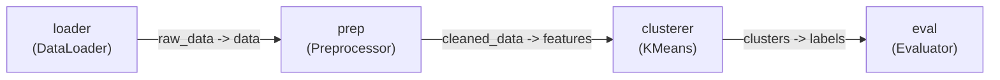

# FinForge AI — Pipeline Graph Specification

This document provides a comprehensive architectural guide to the **Pipeline Graph** subsystem in FinForge AI (`finforge.pipeline`), implemented in issue **FF-08**.

---

## 1. What is a Pipeline Graph?

In FinForge AI, complex artificial intelligence and machine learning workflows are modeled as a **Directed Acyclic Graph (DAG)**:

- **Directed**: Data flows in a specific direction from producer components to consumer components.
- **Acyclic**: The graph contains no feedback loops or cycles; computation proceeds strictly forward from upstream sources to downstream sinks.
- **Graph**: A mathematical collection of vertices (**nodes**) connected by directed links (**edges**).



---

## 2. Core Graph Primitives

### Nodes (`PipelineNode`)

A [`PipelineNode`](file:///home/lucky/QFIS/financial-rag-ml-team/src/finforge/pipeline/models.py) represents an individual algorithmic or data-processing step in the pipeline.

- **`node_id`** (`str`): Unique identifier within the graph (e.g. `"loader"`, `"feature_extractor"`).
- **`component_name`** (`str`): Name of a component registered in the [`ComponentRegistry`](file:///home/lucky/QFIS/financial-rag-ml-team/src/finforge/registry/registry.py).
- **`config`** (`dict[str, Any]`): Parameter dictionary that will be supplied to the component during future lifecycle execution (`setup(config)`).
- **`metadata`** (`dict[str, Any]`): Arbitrary key-value metadata for tagging, observability, or UI rendering.

> [!NOTE]
> A node references registered component metadata. It **never instantiates** the component class or invokes component lifecycle methods during graph construction.

### Edges (`PipelineEdge`)

A [`PipelineEdge`](file:///home/lucky/QFIS/financial-rag-ml-team/src/finforge/pipeline/models.py) represents a directed data flow connecting two component ports:

- **`source_node_id`** (`str`): The producer node emitting data.
- **`source_port`** (`str`): Name of the declared output port on the producer component manifest.
- **`destination_node_id`** (`str`): The consumer node receiving data.
- **`destination_port`** (`str`): Name of the declared input port on the consumer component manifest.

---

## 3. Port Connections and Type Compatibility

When adding an edge (`graph.add_edge(...)`), FinForge statically inspects the declared component manifests in the registry:

1. **Port Existence**: Verifies that `source_port` is declared in `outputs` of the producer manifest, and `destination_port` is declared in `inputs` of the consumer manifest. Missing ports raise [`PortNotFoundError`](file:///home/lucky/QFIS/financial-rag-ml-team/src/finforge/exceptions.py).
2. **Type Compatibility**: Reuses the static contract engine (`finforge.contracts.check_port_compatibility`) to ensure data types can be legally connected:
   - **Exact Match**: Compatible (e.g. `string` -> `string`, `tensor` -> `tensor`).
   - **Numeric Promotion**: `integer` output promotes safely to `number` or `float` input.
   - **No Narrowing**: `number`/`float` output **cannot** connect to `integer` input.
   - **Arrays**: Nested item definitions are verified recursively.
   - Incompatible types raise [`PortIncompatibleError`](file:///home/lucky/QFIS/financial-rag-ml-team/src/finforge/exceptions.py).
3. **Zero Code Execution**: Type compatibility is evaluated purely on declarative manifest metadata; no user code is imported or executed.

---

## 4. Graph Invariants & Validation

The [`PipelineGraph.validate()`](file:///home/lucky/QFIS/financial-rag-ml-team/src/finforge/pipeline/graph.py) method enforces strict structural invariants:

| Invariant | Description | Error Raised on Violation |
|---|---|---|
| **Node Existence** | All edge coordinates must reference existing nodes. | `NodeNotFoundError` / `GraphValidationError` |
| **Component Registration** | All nodes must reference components present in the registry. | `ComponentNotFoundError` / `GraphValidationError` |
| **No Self-Loops** | A node cannot connect an output directly to one of its inputs (`src == dst`). | [`SelfLoopError`](file:///home/lucky/QFIS/financial-rag-ml-team/src/finforge/exceptions.py) |
| **No Duplicate Edges** | The exact same edge connection cannot be added more than once. | [`DuplicateEdgeError`](file:///home/lucky/QFIS/financial-rag-ml-team/src/finforge/exceptions.py) |
| **Single Incoming Connection** | An input port cannot have multiple incoming edges by default. | [`InvalidEdgeError`](file:///home/lucky/QFIS/financial-rag-ml-team/src/finforge/exceptions.py) |
| **Acyclicity (DAG)** | The graph must contain no directed cycles. | [`CycleDetectedError`](file:///home/lucky/QFIS/financial-rag-ml-team/src/finforge/exceptions.py) |

### Why Are Multiple Connections to a Single Input Rejected?

By default, an input port accepts a single incoming edge. If two independent nodes could connect to the same input port, the runtime behavior would be inherently ambiguous:
- Should the inputs be concatenated?
- Should the second overwrite the first?
- Should they be collected into a list?

To preserve deterministic execution, FinForge requires combining data using **explicit merge/aggregator components** (e.g. a concatenation component that accepts multiple named inputs and produces a merged output).

---

## 5. Cycle Detection and Reachability

Cycle detection is implemented using two complementary algorithms:

1. **Incremental Cycle Prevention (`_has_path` via BFS)**:
   When `graph.add_edge(source, ..., dest, ...)` is called, the graph checks whether a path already exists from `dest` to `source`. If `dest` can reach `source`, adding an edge `source -> dest` would close a cycle. The operation is immediately rejected with [`CycleDetectedError`](file:///home/lucky/QFIS/financial-rag-ml-team/src/finforge/exceptions.py).
2. **Whole-Graph Cycle Verification (3-Color DFS)**:
   During [`graph.validate()`](file:///home/lucky/QFIS/financial-rag-ml-team/src/finforge/pipeline/graph.py), a complete 3-color depth-first search (`WHITE=unvisited`, `GRAY=visiting`, `BLACK=visited`) scans all nodes across all connected and disconnected graph components, returning the exact cycle path if one exists.

---

## 6. Deterministic Topological Ordering

The method [`graph.execution_order()`](file:///home/lucky/QFIS/financial-rag-ml-team/src/finforge/pipeline/graph.py) returns an ordered list of node IDs satisfying all directed dependencies using **Kahn's algorithm**:

1. Calculates the in-degree of all nodes.
2. Identifies all nodes with in-degree `0` (roots / nodes with no unresolved upstream inputs).
3. Maintains available nodes in a **min-heap priority queue** (`heapq`).
4. **Deterministic Tie-Breaking**: When multiple nodes are ready, the node with the lexicographically smallest `node_id` is processed first.
5. Decrements the in-degree of downstream neighbors and enqueues them as they reach `0`.
6. If the number of processed nodes is less than the total node count, a cycle is detected and [`CycleDetectedError`](file:///home/lucky/QFIS/financial-rag-ml-team/src/finforge/exceptions.py) is raised.

> [!IMPORTANT]
> Topological ordering represents **dependency resolution order**, not execution itself. Running `execution_order()` performs purely mathematical graph traversal and never executes component code.

---

## 7. Python Pipeline Builder API (`Pipeline`)

While [`PipelineGraph`](file:///home/lucky/QFIS/financial-rag-ml-team/src/finforge/pipeline/graph.py) serves as the core graph engine, developers typically construct workflows using the high-level [`Pipeline`](file:///home/lucky/QFIS/financial-rag-ml-team/src/finforge/pipeline/builder.py) builder API.

### Why Does the Builder Exist?

The `Pipeline` builder provides an intuitive, expressive interface over `PipelineGraph`:
- Simplified method verbs (`add`, `remove`, `connect`, `disconnect`).
- Pipeline naming and structured metadata tracking (`name`, `description`, `summary()`).
- Direct integration with `ComponentRegistry` without boilerplate.
- **Strict Delegation**: The builder does not duplicate graph state or maintain shadow structures; all mutations delegate directly to the underlying `PipelineGraph`.

### Initializing a Pipeline

```python
from finforge import Pipeline
from finforge.registry import ComponentRegistry

# 1. With an explicit registry
registry = ComponentRegistry()
# ... register components ...
pipeline = Pipeline(
    name="customer-segmentation",
    registry=registry,
    description="Clusters customer behavioral metrics.",
)

# 2. Or with an isolated default registry
isolated_pipeline = Pipeline(name="experiment-v1")
```

### Adding and Removing Nodes

```python
# Add component nodes
pipeline.add("loader", "data-loader", config={"source": "customers.csv"})
pipeline.add("prep", "data-preprocessor", config={"normalize": True})
pipeline.add("cluster", "custom-kmeans", config={"k": 4})

# Retrieve or inspect
node = pipeline.get("loader")
all_nodes = pipeline.list()  # or pipeline.nodes

# Remove node (cascades to remove connected edges)
pipeline.remove("loader")
```

### Connecting Ports

```python
# Connect producer output to consumer input
pipeline.connect(
    source_node="loader",
    source_port="raw_data",
    destination_node="prep",
    destination_port="data",
)

# Disconnect
pipeline.disconnect("loader", "raw_data", "prep", "data")
```

### Validation, Ordering, and Introspection

```python
# Validate DAG invariants and port contracts
pipeline.validate()

# Get deterministic topological dependency order
order = pipeline.execution_order()
print(order)  # ['loader', 'prep', 'cluster']

# Structured diagnostics summary
summary = pipeline.summary()
print(summary)
# {
#     "name": "customer-segmentation",
#     "description": "Clusters customer behavioral metrics.",
#     "node_count": 3,
#     "edge_count": 2,
#     "nodes": ["loader", "prep", "cluster"],
#     "edges": ["loader.raw_data -> prep.data", "prep.cleaned_data -> cluster.features"],
#     "component_names": ["custom-kmeans", "data-loader", "data-preprocessor"]
# }
```

### Why Constructing a Pipeline Does Not Execute It

FinForge AI strictly decouples **pipeline definition** from **pipeline execution**:
1. **Separation of Concerns**: Building a pipeline is a declarative and structural operation. It verifies schemas, type compatibility, and acyclicity before committing runtime resources.
2. **Safety & Predictability**: Graph validation detects mismatched ports, cycles, or missing dependencies statically, avoiding catastrophic runtime failures mid-execution.
3. **Execution Portability**: A validated graph can be executed by different runtime engines (e.g. local synchronous runtime, distributed execution, GPU workers) without altering the workflow specification.

---

## 8. Local Synchronous Runtime Execution (FF-10)

FinForge AI provides an in-process synchronous runtime engine in `finforge.runtime` for executing validated pipelines.

### Executing a Pipeline

Workflows are executed by calling `pipeline.run(...)`:

```python
result = pipeline.run(
    inputs={"loader": {"source": "data/customers.csv"}},
    context={"environment": "production"},
)

if result.success:
    print(f"Workflow completed in {result.duration_ms:.2f}ms")
    print("Final outputs:", result.outputs)
else:
    print(f"Workflow failed: {result.execution_errors}")
    print("Cleanup errors (if any):", result.cleanup_errors)
```

### Execution Lifecycle & Semantics

1. **Graph Validation**: The pipeline graph is validated prior to execution (`graph.validate()`). Structural flaws (cycles, missing ports, type mismatches) raise exceptions immediately.
2. **Topological Order**: Kahn's algorithm resolves deterministic node execution order.
3. **Data Passing & Isolation**:
   - Upstream output port values are mapped to connected downstream input ports.
   - External inputs are mapped directly to target node input ports (`inputs={"node_id": {"port": val}}`).
   - All data passed between components is deep-copied; components cannot mutate upstream outputs or external inputs.
4. **Contract Enforcement**: Every node's inputs and outputs are validated at runtime against declared component manifest schemas using `validate_inputs` and `validate_outputs`.
5. **Component Instantiation**: Each node receives a fresh, independent component instance (`type[BaseComponent]()`). Component instances are never reused across different nodes.
6. **Setup and Run**: `instance.setup(config)` is called first. Only if `setup()` succeeds is `instance.run(inputs, context)` called.
7. **Guaranteed Teardown**: In a `finally` block, `instance.teardown()` is executed in reverse initialization order for every successfully initialized component. If teardown fails, cleanup errors are captured and reported without aborting the teardown of remaining components.
8. **Fail-Fast Semantics**: If a node fails, execution terminates immediately, and downstream or unexecuted nodes are marked with status `SKIPPED`. Partial outputs are preserved in `result.outputs` for debugging.

### Execution Safety & Trusted Code

> [!CAUTION]
> **No Sandboxing**: The local synchronous runtime executes component code directly in the local Python process with the caller's system privileges.
> Only run pipelines composed of **trusted components**. Containerized and microVM isolation will be introduced in future milestones.

---

## 9. Low-Level `PipelineGraph` API

If programmatic graph manipulation without the high-level builder wrapper is preferred:

```python
from finforge.pipeline import PipelineGraph
from finforge.registry import ComponentRegistry

# Initialize registry and graph
registry = ComponentRegistry()
# ... register components ...
graph = PipelineGraph(registry=registry)

# Add nodes
graph.add_node("loader", "data-loader", config={"batch_size": 32})
graph.add_node("prep", "preprocessor")
graph.add_node("model", "kmeans-clusterer", config={"k": 5})

# Connect ports
graph.add_edge("loader", "dataset", "prep", "raw_data")
graph.add_edge("prep", "cleaned_data", "model", "features")

# Validate graph
graph.validate()

# Get deterministic dependency ordering
order = graph.execution_order()
print(order)  # ['loader', 'prep', 'model']
```

---

## 10. Pipeline Serialization (FF-11)

FinForge AI provides declarative, versioned YAML serialization and deserialization for pipelines. This allows workflows to be saved to disk, shared, inspected, and reconstructed across environments.

### 10.1 Saving a Pipeline (`pipeline.save`)

A constructed and validated `Pipeline` or `PipelineGraph` can be serialized directly:

```python
# Save pipeline to YAML file
pipeline.save("customer_segmentation.yaml")

# Explicitly allow overwriting an existing file
pipeline.save("customer_segmentation.yaml", overwrite=True)
```

**Guarantees**:
- **Atomic Writes**: Writes to a temporary hidden file in the destination directory (`.tmp_*`) before replacing the target file, ensuring zero partial or corrupted files if serialization fails.
- **Deterministic Output**: Node IDs and edges are sorted deterministically, producing bit-for-bit identical YAML across multiple runs.
- **Accidental Overwrite Protection**: Raises `FileExistsError` if target exists and `overwrite=False`.
- **Pure Structural State**: Only pipeline metadata, node IDs, component names, primitive configurations, and port edges are persisted. Runtime state, component class instances, execution outcomes, and transient buffers are never serialized.

### 10.2 Loading a Pipeline (`Pipeline.load`)

To reconstruct a pipeline from YAML:

```python
from finforge import Pipeline
from finforge.registry import ComponentRegistry

# Initialize registry with required component classes
registry = ComponentRegistry()
# ... register data-loader, data-preprocessor, kmeans ...

# Load and validate reconstructed pipeline
pipeline = Pipeline.load("customer_segmentation.yaml", registry=registry)
```

**Requirements & Invariants**:
- **Explicit Registry**: Requires an explicitly supplied `ComponentRegistry`. FinForge uses zero hidden global state.
- **Missing Components**: If any component referenced in the YAML is not registered, deserialization fails cleanly with [`PipelineDeserializationError`](file:///home/lucky/QFIS/financial-rag-ml-team/src/finforge/exceptions.py).
- **Zero Dynamic Imports**: Component classes must be registered before loading. FinForge will never dynamically import Python modules or fetch remote packages during deserialization.
- **Zero Execution**: Loading deserializes metadata and validates graph structure only. Components are **never instantiated**, and lifecycle methods (`setup()`, `run()`) are never called during loading.

### 10.3 Declarative YAML Specification (`format_version: "1"`)

```yaml
format_version: "1"

name: customer-segmentation
description: Identifies customer segments from raw transaction logs
metadata:
  environment: production
  author: data-team

nodes:
  - id: loader
    component: data-loader
    config:
      batch_size: 100
      source_path: s3://data/txs.parquet

  - id: preprocessor
    component: data-preprocessor
    config:
      scale_factor: 2.0

  - id: cluster
    component: custom-kmeans
    config:
      n_clusters: 3

edges:
  - source_node: loader
    source_port: raw_data
    destination_node: preprocessor
    destination_port: data

  - source_node: preprocessor
    source_port: processed_data
    destination_node: cluster
    destination_port: data
```

#### Specification Fields

| Field | Type | Required | Description |
|---|---|---|---|
| `format_version` | `str` | Yes | Specification version. Must be `"1"`. Future versions will provide migration paths. |
| `name` | `str` | Yes | Unique identifier name for the pipeline. |
| `description` | `str` | No | Human-readable explanation of workflow purpose. |
| `metadata` | `dict` | No | Arbitrary key-value metadata containing YAML-safe primitives. |
| `nodes` | `list` | Yes | List of node specifications. Duplicate `id` values are rejected. |
| `nodes[].id` | `str` | Yes | Unique identifier for the node within this workflow. |
| `nodes[].component` | `str` | Yes | Name of the registered component in `ComponentRegistry`. |
| `nodes[].config` | `dict` | No | Component configuration dictionary (YAML-safe primitives only). |
| `edges` | `list` | Yes | List of directed data flow connections between component ports. |
| `edges[].source_node` | `str` | Yes | ID of producer node. Must reference an existing node. |
| `edges[].source_port` | `str` | Yes | Name of declared output port on producer component manifest. |
| `edges[].destination_node` | `str` | Yes | ID of consumer node. Must reference an existing node. |
| `edges[].destination_port` | `str` | Yes | Name of declared input port on consumer component manifest. |

### 10.4 Configuration & Secret Restrictions

To safeguard against remote code execution and credential leakage:

1. **Permitted Primitive Types**: Configurations may only contain strings, integers, floating-point numbers, booleans, `None`, lists of primitives, and dictionaries with string keys.
2. **Rejected Types**: Complex Python objects, custom classes, functions, and lambdas raise [`PipelineSerializationError`](file:///home/lucky/QFIS/financial-rag-ml-team/src/finforge/exceptions.py).
3. **YAML Tag Restrictions**: Custom YAML tags (such as PyYAML's `!!python/object` or `!!python/apply`) are rejected with [`SerializationFormatError`](file:///home/lucky/QFIS/financial-rag-ml-team/src/finforge/exceptions.py).
4. **Secret Handling**: Sensitive credentials, tokens, or API keys should **never** be hardcoded in pipeline YAML definitions. Component configurations should reference secret names or rely on environment variables (`FINFORGE_*`) at runtime.

### 10.5 CLI Inspection (`finforge inspect`)

Pipelines can be inspected without executing any code or instantiating components using the CLI:

```bash
# Pretty-print pipeline topology
finforge inspect path/to/pipeline.yaml

# Output machine-readable JSON topology
finforge inspect path/to/pipeline.yaml --json
```

Displays:
- Pipeline name and format version.
- Nodes and registered component associations.
- Component configuration keys.
- Direct port-to-port connections.
- Deterministic topological dependency ordering.

---

## 11. Current State vs. Future Capabilities

| Capability | Current State (FF-08 through FF-11) | Future Milestone |
|---|---|---|
| **Graph Structure** | Implemented (`PipelineNode`, `PipelineEdge`, `PipelineGraph`). | Visual pipeline designer and drag-and-drop editor. |
| **Pipeline Builder** | Implemented (`Pipeline` with `add`, `connect`, `validate`, `run`, `summary`). | Interactive Jupyter widget builder. |
| **Serialization** | Implemented (declarative YAML `save()`, `load()`, `format_version: "1"`). | Online marketplace and remote registry persistence. |
| **Inspection** | Implemented (`finforge inspect <pipeline.yaml>`, rich table / JSON). | Pipeline diffing and automated visual schema diagramming. |
| **Port Validation** | Implemented (static type compatibility via FF-03 & FF-04). | Dynamic type-coercion adapters. |
| **Ordering** | Implemented (deterministic topological order via Kahn's algorithm). | Parallel execution wave generation. |
| **Execution** | Implemented (`pipeline.run(...)`, `LocalSynchronousExecutor`). | Asynchronous streaming and distributed workers. |
| **Branching** | Static DAG branching and multi-consumer fanout supported. | Dynamic conditional branching. |
