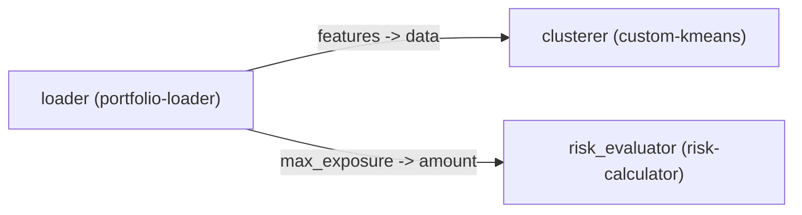

# Pipeline: portfolio-risk-clustering

> End-to-end financial portfolio risk clustering and assessment workflow

## Topology Diagram

## Nodes & Components

| Node ID | Component | Config Keys |
| :--- | :--- | :--- |
| `loader` | `portfolio-loader` | `volatility_scale` |
| `clusterer` | `custom-kmeans` | `n_clusters`, `max_iter` |
| `risk_evaluator` | `risk-calculator` | `threshold` |

## Port Connections

| Source | Destination |
| :--- | :--- |
| `loader.features` | `clusterer.data` |
| `loader.max_exposure` | `risk_evaluator.amount` |
